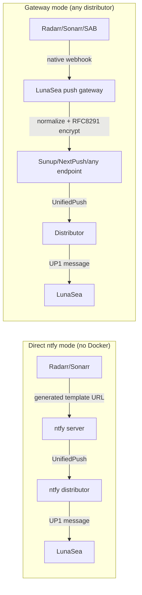
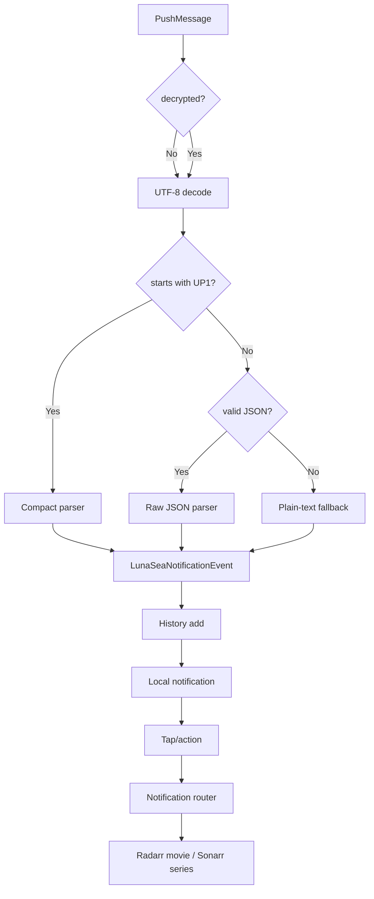

# LunaSea UnifiedPush, Rich Notifications, Any-Distributor Gateway & Developer Workbench

**Execution plan — detailed implementation specification**

| Field | Value |
|---|---|
| Document status | Ready for implementation |
| Date | 2026-10-28 |
| Repository | `/home/wdreyer/Downloads/lunasea` |
| App | LunaSea 11.0.0+1, Flutter 3.29.3 / Dart 3.7.2 |
| Primary target | Android (physical device available) |
| Existing implementation | Partial UnifiedPush implementation present; extend and harden |
| Default push mode | **ntfy direct, no Docker relay required** |
| Optional push mode | **Self-hosted Node/Docker gateway for Sunup/NextPush/any UnifiedPush distributor** |
| Workbench | Static HTML/JS under `docs/push-workbench/` |
| Runtime verification | Physical Android device with ntfy and Sunup |

---

## 1. Executive summary

LunaSea’s current UnifiedPush work is a useful prototype, but it cannot yet deliver the promised experience:

- It exposes the raw UnifiedPush endpoint as the Radarr/Sonarr webhook URL.
- Real Radarr/Sonarr payloads can exceed ntfy’s 4 KB message limit and become `attachment.json` events.
- It has no reliable startup re-registration.
- It has no reactive settings UI, distributor picker, test notification, notification actions, deep links, or history screen.
- The manifest contains a receiver that does not exist.
- The current unconditional `unifiedpush` import breaks web builds because the package imports `dart:io`.
- The background entrypoint argument is not available in the pinned plugin version.
- It cannot support Sunup or other encrypted UnifiedPush distributors with native webhooks.

This plan fixes those issues and delivers two transport paths:

1. **Direct ntfy mode — no gateway, no Docker, no custom server**
   - Radarr/Sonarr post to generated ntfy template URLs.
   - ntfy transforms the large JSON body into a compact `UP1` message.
   - The ntfy distributor forwards the message to LunaSea.
   - This remains fully supported and is the default for ntfy users.

2. **Optional gateway mode — any UnifiedPush distributor**
   - A small self-hosted Node/Docker service receives native Radarr/Sonarr/SABnzbd webhooks.
   - It normalizes the payload and encrypts it with RFC 8291 WebPush for Sunup, NextPush, or any other distributor.
   - It can also relay to ntfy in plaintext if the user prefers gateway mode.
   - The gateway is optional; the app never requires it.

In both modes, the app experience is identical: rich notification, history, actions, poster, and deep links.

---

## 2. Locked decisions

| Area | Decision | Rationale |
|---|---|---|
| Existing code | Extend and harden, do not rewrite | The prototype has useful structure; rewriting adds risk |
| Workbench | Static HTML/JS under `docs/push-workbench/` | Browser-based, no app bloat, can dispatch to ntfy/gateway |
| ntfy transport | Generated inline-template webhook URLs | Solves the 4 KB attachment problem and preserves rich fields |
| Sunup / any distributor | Optional Node/Docker gateway | Native webhooks cannot perform RFC 8291 encryption |
| App feature parity | Same notification/history/deep-link UX for ntfy and Sunup | The app receives a normalized `UP1` message in both modes |
| Gateway hosting | Docker/Node available on the media server or LAN | User confirmed availability |
| Device testing | Physical Android device | Real distributor/battery/background behavior |
| SABnzbd | Script, because SABnzbd has no native arbitrary webhook | Required for SAB support |
| ntfy without Docker | First-class, default mode | Explicit user requirement |
| Platform scope | Android runtime behavior; web/desktop builds must remain valid | Preserve LunaSea’s multi-platform build |

---

## 3. Goals and non-goals

### 3.1 Goals

- Replace the defunct FCM path with a working UnifiedPush notification pipeline.
- Keep the entire ntfy path serverless and Docker-free.
- Support native Radarr/Sonarr webhooks without custom glue.
- Solve ntfy’s 4 KB payload/attachment failure.
- Support Sunup, NextPush, and other encrypted distributors through an optional gateway.
- Provide identical rich notification behavior across distributors:
  - Title/body with source, event, quality, size, indexer, release group.
  - Media poster or fallback badge.
  - `View` and `Dismiss` actions.
  - Deep links to Radarr movie details and Sonarr series details.
  - In-app notification history.
  - Test notification.
  - Android 13 permission handling.
- Provide a distributor picker and endpoint/key display.
- Provide generated Radarr and Sonarr webhook URLs.
- Provide an optional gateway URL generator.
- Keep configuration backup/restore safe: never restore a device-specific endpoint or secret.
- Deliver an interactive browser workbench with architecture, payload studio, URL generator, dispatcher, patch explorer, and patch download.
- Rewrite the inaccurate build guide.
- Add automated parser/URL tests and gateway tests.
- Preserve `flutter build web`, `flutter build apk`, and existing modules.

### 3.2 Non-goals

- Building a general-purpose UnifiedPush application server for all apps.
- Supporting iOS push in this project.
- Implementing a full in-app HTTP relay/foreground server on the phone.
- Replacing LunaSea’s existing LunaSea account/cloud backup system.
- Publishing a hosted gateway service.
- Solving every Radarr/Sonarr event type in the first release; the schema is extensible.
- Supporting arbitrary non-ntfy plaintext distributors without a gateway as a guarantee.
- Fixing the repository’s 842 pre-existing analyzer infos/warnings.
- Redesigning unrelated settings or modules.

---

## 4. Glossary

| Term | Meaning |
|---|---|
| UnifiedPush | Open push-notification standard with a user-selected distributor app |
| Distributor | Android app that receives push messages and forwards them to apps (ntfy, Sunup, NextPush) |
| Connector | App-side library that registers with a distributor and receives messages |
| Endpoint | Capability URL supplied by the distributor; messages posted here reach the device |
| `p256dh` | WebPush public key for RFC 8291 encryption |
| `auth` | WebPush auth secret for RFC 8291 encryption |
| VAPID | RFC 8292 sender authorization; optional for some distributors, required by others |
| RFC 8291 | WebPush message encryption standard |
| `UP1` | Compact LunaSea notification payload format defined by this plan |
| Gateway | Optional small Node service that receives webhooks and encrypts/forwards to a distributor |
| Direct mode | Radarr/Sonarr → ntfy template URL → device; no gateway |
| Gateway mode | Radarr/Sonarr/SAB → gateway → encrypted WebPush → device |
| Workbench | Static browser tool for generating URLs, editing payloads, and testing dispatch |

---

## 5. Current-state audit

### 5.1 Environment

| Item | Current value |
|---|---|
| Flutter | 3.29.3 |
| Dart | 3.7.2 |
| Java | 17 |
| Android SDK platforms | 31, 34, 35, 36 |
| Android build-tools | 33, 34 |
| Emulator images | None at audit time (physical device now available) |
| App compileSdk | 35 |
| App targetSdk | 35 |
| minSdk | 24 |
| AGP | 8.2.1 |
| Gradle | 8.4 |
| Kotlin | 2.1.0 |
| `unifiedpush` | 6.1.0 |
| `unifiedpush_android` lock | 3.1.1 |
| `flutter_local_notifications` | ^17.2.2 (resolved 17.2.4) |
| `dio` | 5.x |
| `path_provider` | 2.x |
| Hive | 2.x |
| Router | go_router 14.8.1 |
| Localization | easy_localization 3.0.2 |

Git state at audit: single `init` commit on `main`; only `.android/cache` files were modified/uncommitted. Do not touch unrelated working-tree changes.

### 5.2 Files already present

| File | Current role | Status |
|---|---|---|
| `lib/core/services/unifiedpush_service.dart` | Singleton push service, local notifications, raw history | Prototype; incomplete |
| `lib/core/models/notification/unifiedpush_payload.dart` | Raw JSON parser and formatting | Prototype; missing IDs, compact format, history reconstruction |
| `lib/modules/settings/routes/notifications/unifiedpush_settings.dart` | Plain Material settings page | Prototype; not Luna-themed, raw endpoint only |
| `lib/main.dart` | Initializes push after bootstrap, dead background-arg check | Needs background bootstrap and non-fatal handling |
| `android/app/src/main/AndroidManifest.xml` | Bogus `PluginReceiver`, unused boot receiver | Needs cleanup |
| `docs/UNIFIEDPUSH_BUILD_GUIDE.md` | Outdated, inaccurate guide | Rewrite |
| `pubspec.yaml` | UnifiedPush dependencies | Needs `flutter_test` and plugin upgrade |
| `pubspec.lock` | Pins `unifiedpush_android 3.1.1` | Upgrade for `--unifiedpush-bg` |

### 5.3 What the prototype already does

- Declares `unifiedpush 6.1.0` and `flutter_local_notifications`.
- Creates a high-importance notification channel.
- Registers UnifiedPush callbacks.
- Parses basic Radarr, Sonarr, and SABnzbd JSON.
- Formats a simple title/body.
- Stores history in a raw Hive box.
- Shows a basic settings page with distributor refresh, register/unregister, endpoint copy.
- Initializes after LunaSea bootstrap.

### 5.4 Problems that must be addressed

#### Service lifecycle

- `UnifiedPush.initialize()` returns whether a distributor is saved, but the result is ignored.
- `register()` is never called at startup. The UnifiedPush library requires registration at every app startup with the same instance/distributor.
- No `onTempUnavailable` callback.
- No distributor picker; `registerApp()` silently picks the first distributor.
- No `vapid` support for distributors that require it.
- No endpoint public key/auth secret storage; required for the gateway.
- No test notification.
- No reactive state; the async `onNewEndpoint` callback cannot update the UI.
- No timeout or “waiting for endpoint” state.
- `unregisterApp()` leaves stale distributor/keys in places.
- Uses ad-hoc Hive boxes (`unifiedpush_settings`, `notification_history`) instead of the repository’s `LunaBox`/`LunaSeaDatabase` conventions.
- No backup/restore exclusion for device-specific secrets.
- No migration from the prototype’s boxes.

#### Payload handling

- Assumes every message is UTF-8 JSON.
- No compact `UP1` parser.
- Does not check `message.decrypted`; Sunup/gateway messages need handling.
- Raw Radarr/Sonarr payloads can exceed ntfy’s 4 KB limit; the app cannot recover the attachment payload.
- No media IDs, so no deep links.
- No season/episode fields in the model.
- `sizeBytes` only accepts `int`; ntfy templates can output scientific notation (`1.234e+08`).
- Quality extraction does not use `movieFile.quality.quality.name` / `episodeFile.quality.quality.name`.
- `remoteMovie` handling is incomplete.
- Health/Test/Delete/Upgrade events are not modeled distinctly.
- No poster URL.
- No `fromMap`, so history cannot reconstruct a usable event.
- No oversized-attachment detection or actionable error.
- No dedup/replay consideration.
- Logs full payloads; privacy risk in release logs.

#### Notification rendering

- `BigTextStyleInformation('')` produces an empty expanded body.
- No actions (`View`, `Dismiss`).
- No grouping.
- No large icon/poster.
- Notification ID is a timestamp, not tied to history.
- Payload is only a source tag; tapping does nothing.
- No cold-start tap handling via `getNotificationAppLaunchDetails()`.
- No background action callback.
- No permission request for Android 13+.
- Notification icon uses the launcher mipmap, which can render as a colored square in the status bar.

#### Settings UI

- Plain `Scaffold`/`ListView`/`Card`, not the LunaSea design system.
- Copy says “Endpoint copied,” but the raw endpoint is not a working Radarr/Sonarr webhook for large payloads.
- No generated Radarr/Sonarr URLs.
- No gateway configuration.
- No “gateway required” warning for Sunup/NextPush.
- No history link.
- No setup instructions for distributor installation, battery optimization, or self-hosted ntfy.
- No localization.
- Uses direct `Navigator.push` instead of a `SettingsRoutes` entry.
- No Android-only guard.

#### Build/platform

- `unifiedpush_service.dart` imports `package:unifiedpush/unifiedpush.dart` unconditionally; `unifiedpush` imports `dart:io`, so `flutter build web` fails.
- `main.dart` imports the service unconditionally on all platforms.
- `unifiedpush_android 3.1.1` does not pass `--unifiedpush-bg`; the dead check means the full app may run in a headless background engine.
- A push initialization failure enters `LunaRecoveryMode`, which is too aggressive.
- The manifest declares `org.unifiedpush.flutter.connector.PluginReceiver`, which does not exist in the plugin.
- The plugin only declares `UnifiedPushService`; the bogus receiver is harmless but misleading.
- `ScheduledNotificationBootReceiver` is declared without `RECEIVE_BOOT_COMPLETED` and is unused.
- No monochrome status icon.
- `unifiedpush_android 3.3.1` uses compileSdk 36 and AGP 8.13.0 internally; app uses AGP 8.2.1. Compatibility must be verified.

#### History/deep links

- History stores only formatted strings plus raw JSON; no IDs/quality/season/episode.
- No history route or UI.
- No retention limit.
- No delete/clear.
- No deep-link navigation.

#### Documentation

- The build guide references `Hive.initFlutter()` and `LunaSeaApp`, which are not the actual entrypoint.
- It says to add `PluginReceiver`, which is wrong.
- It tells users to copy the raw endpoint, which fails for large payloads.
- No Sunup, gateway, SABnzbd, self-hosted ntfy, security, or troubleshooting content.
- No mention of Android 13 permission or battery optimization.

### 5.5 Feasibility tests already performed

| Test | Result |
|---|---|
| Direct JSON POST to an ntfy topic | HTTP 200; JSON stored as message text |
| 9 KB JSON body to ntfy | Converted to `attachment.json` event; raw payload not delivered as message text |
| ntfy inline template `?tpl=yes&t=...&m=...` with 9 KB body | Produced a compact message with desired fields |
| Percent-encoded braces in template URL | Works |
| Missing nested template fields | Render as `<no value>`; no server error |
| `up*` ntfy topics accept POST | Works |
| ntfy CORS from browser | Public ntfy responses allow cross-origin reads |
| Sunup/autopush-rs direct plaintext webhook | Not viable for a real payload; WebPush requires RFC 8291 encryption |
| `unifiedpush_android 3.3.1` background argument | Confirmed it executes `main` with `--unifiedpush-bg` |
| `unifiedpush` VAPID support | `UnifiedPush.register(vapid: publicKey)` exists; some distributors require it |
| Device connected during audit | No device at audit; user now confirms a physical Android device |

### 5.6 Audit conclusion

The prototype proves the basic plugin wiring but does not solve the actual delivery contract. The two required fixes are:

1. Replace the raw endpoint copy with generated ntfy template URLs for direct mode.
2. Add an optional gateway for encrypted distributors and a normalized `UP1` payload contract shared by every path.

---

## 6. Requirements

### 6.1 Functional requirements

| ID | Requirement |
|---|---|
| F-01 | The app can register with any installed UnifiedPush distributor. |
| F-02 | The app re-registers automatically on startup when a distributor is saved. |
| F-03 | The app displays the active distributor and endpoint status. |
| F-04 | The app lets the user change distributor and unregister. |
| F-05 | The app can send a local test notification. |
| F-06 | The app requests Android 13+ notification permission before test/registration. |
| F-07 | The app generates a Radarr webhook URL for the current transport mode. |
| F-08 | The app generates a Sonarr webhook URL for the current transport mode. |
| F-09 | With ntfy, generated URLs use `?tpl=yes&t=Radarr|Sonarr&m=...` and require no gateway. |
| F-10 | With an encrypted distributor, generated URLs use the configured gateway and include endpoint/key material. |
| F-11 | The app warns when an encrypted distributor has no gateway. |
| F-12 | The app accepts `UP1` compact messages, raw JSON, and plain text. |
| F-13 | The app normalizes `<no value>`, empty fields, and scientific-notation sizes. |
| F-14 | The app displays rich notifications with source/event/title/quality/size/indexer. |
| F-15 | Notifications include `View` and `Dismiss` actions. |
| F-16 | Tapping a notification or `View` opens the correct Radarr movie or Sonarr series. |
| F-17 | Deep links work when the app is running, backgrounded, or cold-started. |
| F-18 | Notifications are stored in Hive history and survive restart. |
| F-19 | History can be viewed, tapped for deep link, deleted individually, and cleared. |
| F-20 | History is capped to a configurable maximum (default 200). |
| F-21 | The app displays a poster or a graceful source-badge fallback. |
| F-22 | A >4 KB Radarr/Sonarr payload works through direct ntfy template URLs. |
| F-23 | A >4 KB payload works through the gateway to Sunup/NextPush. |
| F-24 | SABnzbd can send compact notifications via script. |
| F-25 | The gateway supports ntfy plaintext and encrypted WebPush. |
| F-26 | The gateway supports optional VAPID. |
| F-27 | The workbench generates both direct and gateway URLs. |
| F-28 | The workbench can dispatch test payloads and display responses. |
| F-29 | The workbench can display current repo files and generate a patch document. |
| F-30 | The documentation explains both modes and the encryption limitation. |

### 6.2 Distributor support matrix

| Distributor | Register/receive in app | Native Radarr/Sonarr webhook | Recommended mode | Notes |
|---|---|---|---|---|
| ntfy | Yes | Yes | **Direct, no Docker** | Plaintext + inline templates |
| ntfy via gateway | Yes | Yes | Optional | Useful for one uniform gateway flow |
| Sunup | Yes | No | **Gateway required** | RFC 8291 encrypted WebPush |
| NextPush | Yes | No | **Gateway required** | RFC 8291 encrypted WebPush; may require VAPID |
| Other encrypted distributor | Yes | No | Gateway required | Generic WebPush path |
| Other plaintext distributor | Maybe | Not guaranteed | Test first | No templating; large/rich payloads may fail |

### 6.3 UX requirements

- Settings screen uses existing LunaSea widgets, colors, and typography.
- Status is obvious: Active / Inactive / Waiting / Error / Temporary endpoint.
- Primary action is “Register” when inactive and “Send Test” when active.
- Generated URLs are one-tap copy.
- The raw endpoint is hidden under “Advanced.”
- The app explains why a gateway is needed for Sunup/NextPush.
- The app explains that ntfy direct mode needs no Docker.
- History is easy to reach and visually consistent with the rest of Settings.
- Empty/error states are actionable.
- No secret is shown by default in logs or snackbars.
- All new user-facing strings are localized.

### 6.4 Non-functional requirements

- `flutter analyze` introduces no new errors.
- `flutter test` passes.
- `flutter build apk --debug` passes.
- `flutter build web` passes.
- Android runtime path is guarded; web/desktop still compile.
- Push failure never blocks app startup.
- Background bootstrap does not run the full UI.
- Gateway has no database and can run in Docker with one container.
- Gateway logs do not contain tokens, endpoints, or keys.
- History writes are bounded in size.
- Network/poster failures never prevent notification delivery.

### 6.5 Security requirements

- Endpoint, `p256dh`, `auth`, gateway token, and gateway VAPID private key are secrets.
- Secrets are excluded from configuration export/backup.
- Secrets are not logged.
- Workbench avoids persistent localStorage for secrets by default.
- Gateway optional token; HTTPS recommended when not on localhost/LAN.
- Gateway validates endpoint scheme and optionally host allowlist to reduce SSRF.
- Documentation warns that ntfy public topics are public and capability URLs are bearer secrets.
- Endpoint rotation is supported by unregister/re-register.

---

## 7. Architecture

### 7.1 Transport modes



### 7.2 Direct ntfy mode — first-class, no Docker

This mode is the default whenever the selected distributor is ntfy and no gateway is configured.

- The app reads the endpoint from `onNewEndpoint`.
- The app builds:
  - Radarr URL: `<endpoint>?tpl=yes&t=Radarr&p=4&m=<encoded template>`
  - Sonarr URL: `<endpoint>?tpl=yes&t=Sonarr&p=4&m=<encoded template>`
- The user pastes that URL into Radarr/Sonarr’s native Webhook connection.
- ntfy transforms the JSON body into a compact `UP1` string.
- ntfy stores/forwards the compact message.
- The app parses `UP1`.
- No Docker, no gateway, no custom server, no cloud function.

**Important:** The app must continue to offer this mode even if a gateway is configured. The UI should show both “Direct ntfy” and “Gateway” options when both are possible.

### 7.3 Gateway mode — any distributor

- The gateway is optional and self-hosted.
- The app stores the gateway base URL, optional token, and VAPID public key.
- The app builds:
  - `<gatewayBase>/push?source=radarr&endpoint=<encoded>&p256dh=<encoded>&auth=<encoded>&token=<encoded>`
  - `<gatewayBase>/push?source=sonarr&endpoint=<encoded>&p256dh=<encoded>&auth=<encoded>&token=<encoded>`
- The gateway receives the native webhook, normalizes to `UP1`, and:
  - Sends plaintext if the endpoint has no keys (ntfy).
  - Encrypts with RFC 8291 and signs with VAPID if keys are present.
- The app receives the same `UP1` message regardless of transport.

### 7.4 Receive pipeline



### 7.5 Persistence model

| Data | Store | Backup/export |
|---|---|---|
| Endpoint | `LunaSeaDatabase.UNIFIEDPUSH_ENDPOINT` | Excluded |
| Distributor package | `LunaSeaDatabase.UNIFIEDPUSH_DISTRIBUTOR` | Excluded |
| `p256dh` public key | `LunaSeaDatabase.UNIFIEDPUSH_PUBLIC_KEY` | Excluded |
| `auth` secret | `LunaSeaDatabase.UNIFIEDPUSH_AUTH_SECRET` | Excluded |
| Gateway URL | `LunaSeaDatabase.UNIFIEDPUSH_GATEWAY_URL` | Excluded (device-specific) |
| Gateway token | `LunaSeaDatabase.UNIFIEDPUSH_GATEWAY_TOKEN` | Excluded |
| Gateway VAPID public key | `LunaSeaDatabase.UNIFIEDPUSH_GATEWAY_VAPID` | Excluded |
| Notification history | `LunaBox.notifications` | Excluded |
| Old prototype settings | Raw Hive `unifiedpush_settings` | Migrate once, then ignore |
| Old prototype history | Raw Hive `notification_history` | Optional best-effort migration |

### 7.6 Why `LunaBox.notifications`

- Follows the repository’s Hive conventions.
- Opened by `LunaBox.open()` and `LunaDatabase.initialize()`.
- Supports `listenableBuilder` for reactive history UI.
- Can be cleared by existing database reset flows.
- Does not participate in config export.

### 7.7 Why the endpoint must not be backed up

The endpoint is a capability URL: anyone with it can send push messages to the device. `p256dh`/`auth` and the gateway token are also secrets. Restoring them onto another device would either fail or leak capability. After restore, the user must re-register and re-copy webhook URLs.

---

## 8. Payload contract

### 8.1 `UP1` compact schema

Separator: `U+001F` (Unit Separator), represented as `␟` in this document.

| Index | Field | Type | Notes |
|---:|---|---|---|
| 0 | `UP1` | literal | Version marker |
| 1 | `source` | string | `RADARR`, `SONARR`, `SABNZBD`, `UNKNOWN` |
| 2 | `eventType` | string | `Grab`, `Download`, `Upgrade`, `Rename`, `Health`, `Test`, etc. |
| 3 | `mediaId` | string/int | Radarr movie ID or Sonarr series ID |
| 4 | `title` | string | Movie/series/NZB title |
| 5 | `year` | string/int | Movie/series year |
| 6 | `season` | string/int | Sonarr season |
| 7 | `episode` | string/int | Sonarr episode |
| 8 | `episodeTitle` | string | Sonarr episode title |
| 9 | `releaseQuality` | string | Grab quality, e.g. `Bluray-2160p` |
| 10 | `fileQuality` | string | Downloaded file quality |
| 11 | `releaseSize` | number/string | Release size in bytes |
| 12 | `fileSize` | number/string | File size in bytes |
| 13 | `indexer` | string | Indexer name |
| 14 | `releaseGroup` | string | Release group |
| 15 | `downloadClient` | string | Download client |
| 16 | `healthLevel` | string | `warning`, `error`, `notice` |
| 17 | `message` | string | Health message or general text |
| 18 | `posterUrl` | string | Poster URL if available |

### 8.2 Normalization rules

- Strip whitespace around fields.
- Treat `<no value>`, `null`, `undefined`, and empty string as absent.
- Accept decimal/scientific-notation sizes (`1.23456789e+08`) and round to an integer.
- Accept sizes with commas.
- Prefer `fileQuality` over `releaseQuality` when both exist.
- Prefer `fileSize` over `releaseSize` when both exist.
- If `title` is empty, fall back to `message`, then “Media Server Alert”.
- If `eventType` is empty, fall back to `Alert`.
- Unknown extra fields are ignored.
- Missing trailing fields are tolerated.
- Values are not URL-decoded; the compact message is already decoded text.
- Titles containing `U+001F` are unsupported; practically impossible.

### 8.3 ntfy template mapping

#### Radarr

```
UP1␟RADARR␟{{.eventType}}␟{{if .movie}}{{.movie.id}}{{else}}{{.remoteMovie.id}}{{end}}␟{{if .movie}}{{.movie.title}}{{else}}{{.remoteMovie.title}}{{end}}␟{{if .movie}}{{.movie.year}}{{else}}{{.remoteMovie.year}}{{end}}␟␟␟␟{{.release.quality}}␟{{.movieFile.quality.quality.name}}␟{{.release.size}}␟{{.movieFile.size}}␟{{.release.indexer}}␟{{if .movieFile}}{{.movieFile.releaseGroup}}{{else}}{{.release.releaseGroup}}{{end}}␟{{.downloadClient}}␟{{.level}}␟{{.message}}␟{{with .movie}}{{range .images}}{{if eq .coverType "poster"}}{{.remoteUrl}}{{end}}{{end}}{{end}}{{with .remoteMovie}}{{range .images}}{{if eq .coverType "poster"}}{{.remoteUrl}}{{end}}{{end}}{{end}}
```

#### Sonarr

```
UP1␟SONARR␟{{.eventType}}␟{{.series.id}}␟{{.series.title}}␟{{.series.year}}␟{{with .episodes}}{{(index . 0).seasonNumber}}{{end}}␟{{with .episodes}}{{(index . 0).episodeNumber}}{{end}}␟{{with .episodes}}{{(index . 0).title}}{{end}}␟{{.release.quality}}␟{{.episodeFile.quality.quality.name}}␟{{.release.size}}␟{{.episodeFile.size}}␟{{.release.indexer}}␟{{if .episodeFile}}{{.episodeFile.releaseGroup}}{{else}}{{.release.releaseGroup}}{{end}}␟{{.downloadClient}}␟{{.level}}␟{{.message}}␟{{with .series}}{{range .images}}{{if eq .coverType "poster"}}{{.remoteUrl}}{{end}}{{end}}{{end}}
```

### 8.4 ntfy URL construction

```
Uri.parse(endpoint).replace(queryParameters: {
  ...existingQueryParameters,
  'tpl': 'yes',
  't': 'Radarr',      // or Sonarr
  'p': '4',
  'm': template,
}).toString()
```

- Preserve any existing query parameters on the endpoint.
- Percent-encode braces, separators, and spaces.
- `p=4` requests high priority from ntfy; the app still controls local importance.
- `t` gives the ntfy message a useful title; UnifiedPush distributors do not display it as a separate notification.
- The URL is long; this is expected. Radarr/Sonarr accept long webhook URLs.

### 8.5 Gateway normalization

The gateway MUST emit exactly the same `UP1` schema. This is critical: the app parser has one contract.

Gateway mapping:
- Radarr: same field selection as the template, with fallbacks for `movie`/`remoteMovie`, `movieFile`/`release`.
- Sonarr: same field selection, first episode for season/episode/title.
- SABnzbd: `source=SABNZBD`, `eventType=status`, `title=nzb_name`, `message=category`, `releaseSize=bytes`.
- Test: `eventType=Test`; empty media fields.
- Health: `eventType=Health`, `healthLevel=level`, `message=message`.
- Unknown: `source=UNKNOWN`, best-effort title/message.

### 8.6 Raw JSON fallback

The app should still parse raw JSON if a message is not `UP1`:

- Radarr detection: `movie` or `remoteMovie`.
- Sonarr detection: `series` or `episodes`.
- SABnzbd detection: `status` with `nzb_name`/`storage`.
- Generic: `title`/`message`.
- Extract IDs and season/episode where possible.

This fallback keeps backward compatibility and supports debugging/workbench raw dispatch.

### 8.7 Oversized attachment detection

If the payload is JSON with:
- `attachment.name == "attachment.json"` or similar, or
- `message` starting with “You received a file”,

the app should show a notification with:
- Title: `[LunaSea] Payload too large`
- Body: `Use the generated Radarr/Sonarr webhook URL, or configure the gateway.`
- No deep link.

This turns a silent data loss into an actionable message.

### 8.8 Event coverage

| Source | Event | Notification title | Body | Deep link |
|---|---|---|---|---|
| Radarr | Grab | Grabbed | quality · size · indexer | Movie |
| Radarr | Download | Downloaded | quality · group · size | Movie |
| Radarr | Upgrade | Upgraded | quality · group · size | Movie |
| Radarr | Rename | Renamed | new filename | Movie |
| Radarr | MovieDelete | Movie Deleted | title | none |
| Radarr | Health | Health Warning | message | none |
| Radarr | Test | Connection Test | “Push pipeline is working” | none |
| Sonarr | Grab | Grabbed | SxxExx · quality · size | Series |
| Sonarr | Download | Downloaded | SxxExx · quality · group · size | Series |
| Sonarr | Upgrade | Upgraded | SxxExx · quality · size | Series |
| Sonarr | Rename | Renamed | SxxExx | Series |
| Sonarr | SeriesDelete | Series Deleted | title | none |
| Sonarr | EpisodeFileDelete | Episode Deleted | SxxExx | Series |
| Sonarr | Health | Health Warning | message | none |
| Sonarr | Test | Connection Test | “Push pipeline is working” | none |
| SABnzbd | Completed/Failed | Completed/Failed | name · category · size | Optional SAB |
| Unknown | Any | Alert | message | none |

---

## 9. ntfy direct mode — no Docker required

### 9.1 User flow

1. Install the ntfy Android app.
2. Disable battery optimization for ntfy.
3. In LunaSea: Settings → UnifiedPush → Register → select ntfy.
4. Grant notification permission.
5. Copy the generated **Radarr webhook URL**.
6. In Radarr: Settings → Connect → Add → Webhook → paste URL.
7. Enable Grab, Download, Upgrade, Rename, Health; click Test.
8. Repeat with the generated **Sonarr webhook URL**.
9. Done. No Docker, no gateway, no custom server.

### 9.2 URL example

```
https://ntfy.sh/upAbCdEfGhIjKl?tpl=yes&t=Radarr&p=4&m=UP1%1FRADARR%1F%7B%7B.eventType%7D%7D...
```

### 9.3 Why this solves the 4 KB problem

- ntfy measures the **transformed** message, not the original JSON body.
- The template collapses a 9 KB+ payload into a few hundred bytes.
- The app receives a compact message with IDs and quality data.
- No attachment is created.

### 9.4 Self-hosted ntfy

- Use the same URL format with the self-hosted base URL.
- Ensure the device can reach the self-hosted ntfy over HTTPS (preferred) or HTTP on LAN.
- The `up*` topic must be writable by Radarr/Sonarr.
- Recommended: require authentication for reading, allow write-only publishing to the `up*` topic used by the device.
- Do not expose a self-hosted ntfy without TLS/auth to the public internet.

### 9.5 Public ntfy

- Public ntfy topics are public. Anyone who knows the topic can read or write.
- The endpoint is a capability URL; treat it as a secret.
- For privacy, use a self-hosted ntfy or a random high-entropy topic (the distributor generates it).
- Rotate by unregistering and re-registering; old URLs stop working after the endpoint changes.

### 9.6 Edge cases

| Case | Behavior |
|---|---|
| Radarr `Test` event | Missing fields become `<no value>`; parser shows Test |
| Health event | `message`/`level` populate body |
| Large payload | Template keeps message small |
| Missing title | Fallback text |
| Size in scientific notation | Parsed and rounded |
| Template URL with existing query | Existing params preserved |
| Self-hosted ntfy with auth | Endpoint may include auth params; preserved |
| Template syntax error | ntfy test fails; workbench validates before copy |
| ntfy down | Radarr/Sonarr webhook fails; retry/manual send; app unaffected |
| Endpoint changes | Re-copy URLs; old URLs stale |

### 9.7 No-Docker guarantee

The app MUST NOT require:
- Gateway configuration.
- Node.js.
- Docker.
- Any LunaSea-hosted service.
- Any cloud function.

The ntfy direct path is complete on its own. The gateway is an optional add-on.

---

## 10. Optional gateway specification

### 10.1 Why the gateway exists

- Sunup, NextPush, and most UnifiedPush distributors use RFC 8291 encrypted WebPush.
- Radarr/Sonarr native webhooks send plain JSON and cannot encrypt.
- ntfy is special: it accepts plaintext and has server-side templates.
- The gateway is the smallest reliable way to support encrypted distributors with native webhooks and full feature parity.

### 10.2 Deployment shape

- Node.js 20+.
- One dependency: `web-push`.
- Stateless.
- Docker image or `node server.js`.
- Runs on the Radarr/Sonarr host or any LAN machine.
- Outbound HTTPS to the distributor endpoint.

### 10.3 API

#### `GET /health`

Response:

```json
{
  "ok": true,
  "version": "1.0.0",
  "vapidPublicKey": "B..."
}
```

- Never return the private key.
- Used by the app’s “Test gateway” and to copy the VAPID public key.

#### `POST /push`

Query parameters:

| Param | Required | Meaning |
|---|---|---|
| `source` | Yes | `radarr`, `sonarr`, `sabnzbd` |
| `endpoint` | Yes | URL-encoded UnifiedPush endpoint |
| `p256dh` | For encrypted | URL-encoded endpoint public key |
| `auth` | For encrypted | URL-encoded endpoint auth secret |
| `token` | If configured | Gateway shared token |
| `format` | No | `raw` or `compact`; default raw JSON |

Body:
- Raw Radarr/Sonarr/SAB JSON.
- Or `UP1...` text when `format=compact`.

Behavior:
- Parse/validate.
- Normalize to `UP1`.
- If `p256dh` and `auth` are present:
  - `webpush.sendNotification({ endpoint, keys: { p256dh, auth } }, message, { TTL: 86400, urgency: 'high', contentEncoding: 'aes128gcm' })`
- Else:
  - POST plaintext to the endpoint.
  - For ntfy, use `Content-Type: text/plain`.
- Return:

```json
{
  "ok": true,
  "source": "radarr",
  "transport": "webpush",
  "bytes": 312
}
```

#### `POST /push/compact`

- Same as `/push` but body is already `UP1`.
- Intended for the SABnzbd script.
- Still normalizes/validates the prefix.

#### `OPTIONS /push`

- CORS preflight for the workbench.
- Allow configured origins; default `*` for local development.

### 10.4 URL format

```
<gatewayBase>/push?source=radarr&endpoint=<urlencoded>&p256dh=<urlencoded>&auth=<urlencoded>&token=<urlencoded>
```

Example:

```
http://192.168.1.20:8080/push?source=radarr&endpoint=https%3A%2F%2Fpush.example%2F...&p256dh=B...&auth=...&token=...
```

- The URL is a capability secret.
- Radarr/Sonarr URL fields can hold it.
- The app generates it only when the endpoint has keys (encrypted distributor) or when the user explicitly selects gateway mode.

### 10.5 VAPID

- Gateway env:
  - `VAPID_PUBLIC_KEY`
  - `VAPID_PRIVATE_KEY`
  - `VAPID_SUBJECT` (for example `mailto:admin@example.com`)
- Generate:
  - `npx web-push generate-vapid-keys --json`
- `/health` returns the public key.
- The app stores the public key as `UNIFIEDPUSH_GATEWAY_VAPID`.
- When registering with a distributor that requires VAPID, the app passes:
  - `UnifiedPush.register(instance: 'default', vapid: gatewayVapidPublicKey)`
- If the distributor returns `FailedReason.vapidRequired`:
  - The app shows “This distributor requires VAPID. Configure the gateway VAPID public key first.”
  - The user runs the gateway, copies its public key, enters it in LunaSea, and re-registers.
- If the gateway key changes, the user must re-register and regenerate webhook URLs.

### 10.6 Normalization parity

The gateway and ntfy templates must produce the same schema. To prevent drift:

- Put the schema in one documentation table (this plan).
- Share fixture payloads between Dart and Node tests.
- Gateway tests assert exact compact strings.
- Dart tests assert parsing of those exact strings.
- A contract test fixture directory:
  - `test/fixtures/radarr_download.json`
  - `test/fixtures/radarr_test.json`
  - `test/fixtures/sonarr_download.json`
  - `test/fixtures/sonarr_health.json`
  - `test/fixtures/sab_completed.json`
- Optional `tool/check_payload_contract.dart` script.

### 10.7 Gateway security

- `GATEWAY_TOKEN`:
  - If set, require it on every `/push`.
  - Compare with constant-time comparison.
  - The app stores the token and includes it in generated URLs.
- Body limit:
  - Default 1 MB.
  - Return HTTP 413.
- Endpoint validation:
  - Only `http`/`https`.
  - Optionally allowlist hosts via `ALLOWED_ENDPOINT_HOSTS`.
  - Block private IP ranges unless `ALLOW_PRIVATE_ENDPOINTS=true` (needed for self-hosted ntfy on LAN).
- Logging:
  - Never log full query strings.
  - Log source, transport, status, and byte count.
- HTTPS:
  - Use a reverse proxy with TLS if exposed beyond localhost/LAN.
- SSRF:
  - The endpoint is supplied by the app (trusted), but a public gateway could be abused.
  - Token + allowlist + private-IP blocking are the mitigations.
- Rate limiting:
  - Optional simple per-IP limit; not required for LAN.
- CORS:
  - Useful for the workbench; does not replace auth.

### 10.8 Failure modes

| Failure | Gateway response | App/user impact |
|---|---|---|
| Missing endpoint | 400 | Radarr/Sonarr Test fails with clear message |
| Invalid source | 400 | Test fails |
| Invalid JSON | 400 | Test fails |
| Body too large | 413 | Test fails |
| Bad token | 401 | Test fails |
| Endpoint unreachable | 502 | Test fails; retry |
| WebPush rejected | 502 with upstream status | Check VAPID/keys |
| VAPID mismatch | 502/403 | Re-register with correct public key |
| ntfy endpoint down | 502 | Check ntfy server |
| Endpoint changed | 404/410 | Re-register, copy new URL |

### 10.9 Docker

Files:

```text
tools/unifiedpush-gateway/
  package.json
  package-lock.json
  server.js
  normalizer.js
  Dockerfile
  docker-compose.yml
  .env.example
  .dockerignore
  README.md
  test/
    normalizer.test.js
    server.test.js
```

Dockerfile outline:

```dockerfile
FROM node:20-alpine
WORKDIR /app
COPY package*.json ./
RUN npm ci --omit=dev
COPY server.js normalizer.js ./
EXPOSE 8080
CMD ["node", "server.js"]
```

docker-compose outline:

```yaml
services:
  lunasea-push-gateway:
    build: .
    ports:
      - "8080:8080"
    env_file:
      - .env
    restart: unless-stopped
```

### 10.10 Gateway setup summary

```bash
cd tools/unifiedpush-gateway
npm ci
npx web-push generate-vapid-keys --json
cp .env.example .env
# fill in VAPID keys, token, subject
docker compose up -d --build
curl http://localhost:8080/health
```

Then:
1. In LunaSea, enter gateway base URL, token, and VAPID public key.
2. Register with Sunup.
3. Copy the generated gateway webhook URLs.
4. Configure Radarr/Sonarr.
5. Test.

### 10.11 Gateway vs direct ntfy

| Aspect | Direct ntfy | Gateway |
|---|---|---|
| Extra service | No | Yes |
| Docker | No | Yes |
| Sunup/NextPush | No | Yes |
| Native webhooks | Yes | Yes |
| VAPID | No | Optional/required |
| Payload compaction | ntfy template | Gateway normalizer |
| Security | Capability topic | Capability URL + token |
| Recommended for | ntfy users | Sunup/any-distributor users |

---

## 11. App implementation plan

### 11.1 New/changed file map

```text
lib/core/services/unifiedpush_service.dart                 (facade, conditional export)
lib/core/services/unifiedpush/service_io.dart              (Android/iOS/desktop implementation)
lib/core/services/unifiedpush/service_stub.dart            (web/unsupported stub)
lib/core/services/unifiedpush/webhook_urls.dart            (direct + gateway URL builders)
lib/core/services/unifiedpush/payload_codec.dart           (UP1 parse/encode helpers)
lib/core/services/unifiedpush/history.dart                 (Hive history repository)
lib/core/services/unifiedpush/navigation.dart              (deep-link router)
lib/core/models/notification/unifiedpush_payload.dart      (event model, parsers, formatting)
lib/main.dart                                              (background bootstrap, guards)
lib/database/box.dart                                      (notifications box)
lib/database/tables/lunasea.dart                           (push settings, backup exclusions)
lib/modules/settings/routes/notifications/unifiedpush_settings.dart
lib/modules/settings/routes/notifications/notification_history.dart
lib/modules/settings/routes/settings/route.dart
lib/router/routes/settings.dart
localization/settings/en.json
assets/localization/en.json                                (generated)
android/app/src/main/AndroidManifest.xml
android/app/build.gradle
android/app/src/main/res/drawable/ic_stat_lunasea.xml
test/unifiedpush_payload_test.dart
test/unifiedpush_webhook_test.dart
test/fixtures/*.json
tools/unifiedpush-gateway/*
tools/sabnzbd/lunasea-notify.sh
docs/push-workbench/*
docs/UNIFIEDPUSH_BUILD_GUIDE.md
```

### 11.2 Service facade and conditional import

`lib/core/services/unifiedpush_service.dart` becomes:

```dart
export 'unifiedpush/service_stub.dart'
    if (dart.library.io) 'unifiedpush/service_io.dart';
```

- On web: stub, no `dart:io`, no `unifiedpush`, no `flutter_local_notifications`.
- On Android/iOS/desktop: `service_io.dart`.
- Existing imports in `main.dart` and settings continue to work.
- The stub extends `ChangeNotifier` and exposes the same public API.
- The stub reports `isSupported == false`.

`service_io.dart`:
- Imports `dart:io`, `flutter_local_notifications`, `unifiedpush`, `hive`, etc.
- Guards runtime behavior with `LunaPlatform.isAndroid`.
- On iOS/desktop, `initialize` is a no-op or only initializes local notifications? Keep it a no-op to avoid unsupported plugin behavior.
- The settings route is hidden on non-Android.

### 11.3 Service state

`UnifiedPushService extends ChangeNotifier`:

```dart
bool get isSupported
bool get isInitialized
bool get isRegistering
bool get isRegistered
bool get isTemporary
String? get endpoint
String? get distributor
String? get publicKey
String? get authSecret
String? get lastError
String? get gatewayUrl
String? get gatewayToken
String? get gatewayVapid
```

- `isRegistered` is true when an endpoint exists.
- `isTemporary` reflects `PushEndpoint.temporary`.
- `lastError` is set on registration failure/temporary unavailable.
- Call `notifyListeners()` after every state change.

### 11.4 Initialization

```dart
Future<void> initialize({bool background = false}) async {
  if (!LunaPlatform.isAndroid) return;
  WidgetsFlutterBinding.ensureInitialized();

  await _initializeLocalNotifications();
  _loadPersistedState();

  final hasDistributor = await UnifiedPush.initialize(
    onNewEndpoint: _onNewEndpoint,
    onRegistrationFailed: _onRegistrationFailed,
    onUnregistered: _onUnregistered,
    onMessage: _onMessage,
    onTempUnavailable: _onTempUnavailable,
  );

  if (hasDistributor) {
    await UnifiedPush.register(
      instance: 'default',
      vapid: _gatewayVapidOrNull(),
    );
  }

  if (!background) {
    await _handleLaunchDetails();
  }
}
```

Key points:
- `initialize` returns `true` if a distributor is saved.
- `register` is called at every startup.
- `vapid` is passed only when the gateway public key is configured.
- Background mode skips launch-details handling.

### 11.5 Registration flow

```dart
Future<void> registerApp({String? preferredDistributor}) async {
  final distributors = await UnifiedPush.getDistributors();
  if (distributors.isEmpty) throw NoDistributorException();

  final chosen = preferredDistributor ?? await _pickDistributor(distributors);
  await UnifiedPush.saveDistributor(chosen);
  _distributor = chosen;
  _isRegistering = true;
  notifyListeners();

  await UnifiedPush.register(
    instance: 'default',
    vapid: _gatewayVapidOrNull(),
  );

  // Endpoint arrives via callback; UI shows "Waiting for endpoint..."
}
```

- The UI is responsible for showing the picker; the service exposes `getDistributors`.
- `changeDistributor`:
  1. Unregister current instance.
  2. Save new distributor.
  3. Register with new distributor.
  4. Clear old endpoint/keys.
- `unregisterApp`:
  - `UnifiedPush.unregister('default')`.
  - Clear endpoint, keys, temporary.
  - Keep gateway config.
  - Persist.

### 11.6 Callbacks

`_onNewEndpoint(endpoint, instance)`:
- Store `endpoint.url`, `endpoint.pubKeySet?.pubKey`, `endpoint.pubKeySet?.auth`, `endpoint.temporary`.
- Persist.
- `isRegistered = true`.
- `isTemporary = endpoint.temporary`.
- `lastError = null`.
- Notify.
- Log only distributor/`temporary`, not the full endpoint in release.

`_onRegistrationFailed(reason, instance)`:
- `lastError = reason.name`.
- If `reason == FailedReason.vapidRequired`, set a specific error code for the UI.
- `isRegistering = false`.
- Notify.

`_onUnregistered(instance)`:
- Clear endpoint/keys.
- `isRegistered = false`.
- Notify.

`_onTempUnavailable(instance)`:
- `isTemporary = true`.
- `lastError = 'Distributor temporarily unavailable'`.
- Notify.

`_onMessage(message, instance)`:
- Decode with `utf8.decode(message.content, allowMalformed: true)`.
- Parse:
  1. `UP1` compact.
  2. JSON.
  3. Plain text.
  4. Attachment-too-large.
- Add to history.
- Show notification.
- Catch all errors and log without crashing the isolate.

### 11.7 Persistence layer

Add to `LunaSeaDatabase`:

```dart
UNIFIEDPUSH_ENDPOINT<String>(''),
UNIFIEDPUSH_DISTRIBUTOR<String>(''),
UNIFIEDPUSH_PUBLIC_KEY<String>(''),
UNIFIEDPUSH_AUTH_SECRET<String>(''),
UNIFIEDPUSH_GATEWAY_URL<String>(''),
UNIFIEDPUSH_GATEWAY_TOKEN<String>(''),
UNIFIEDPUSH_GATEWAY_VAPID<String>(''),
```

Add an override:

```dart
@override
List get blockedFromImportExport => [
  LunaSeaDatabase.UNIFIEDPUSH_ENDPOINT,
  LunaSeaDatabase.UNIFIEDPUSH_DISTRIBUTOR,
  LunaSeaDatabase.UNIFIEDPUSH_PUBLIC_KEY,
  LunaSeaDatabase.UNIFIEDPUSH_AUTH_SECRET,
  LunaSeaDatabase.UNIFIEDPUSH_GATEWAY_URL,
  LunaSeaDatabase.UNIFIEDPUSH_GATEWAY_TOKEN,
  LunaSeaDatabase.UNIFIEDPUSH_GATEWAY_VAPID,
];
```

Add to `LunaBox`:

```dart
notifications<dynamic>('notifications'),
```

Migration:
- On initialize, if new endpoint is empty, read old `Hive.box('unifiedpush_settings')`.
- Copy `endpoint`, `distributor`, `is_registered` into new entries.
- Do not delete the old box; it is harmless and allows rollback.
- Optionally migrate old `notification_history` maps into `LunaBox.notifications` with best-effort `fromMap`; entries without media IDs show no deep link.

### 11.8 History repository

`NotificationHistory`:

```dart
class NotificationHistory {
  static const int maxEntries = 200;

  static Future<int> add(LunaSeaNotificationEvent event) async {
    final key = await LunaBox.notifications.create(event.toMap());
    await _trim();
    return key;
  }

  static LunaSeaNotificationEvent? get(int key) ...
  static List<HistoryEntry> list() ...
  static Future<void> delete(int key) ...
  static Future<void> clear() ...
  static Future<void> _trim() ...
}
```

- `HistoryEntry` contains the Hive key and the parsed event.
- Sort newest-first by `timestamp`.
- Trim oldest beyond `maxEntries`.
- History page listens to `LunaBox.notifications.listenableBuilder`.
- `clear()` also cancels all notifications for the channel (optional).

### 11.9 History data format

`LunaSeaNotificationEvent.toMap()`:

```json
{
  "source": "radarr",
  "eventType": "Download",
  "title": "Dune: Part Two",
  "subtitle": "2024",
  "year": 2024,
  "mediaId": 42,
  "season": null,
  "episode": null,
  "episodeTitle": null,
  "quality": "Bluray-2160p",
  "releaseGroup": "GRP",
  "indexer": "Indexer",
  "sizeBytes": 123456789,
  "downloadClient": "qBittorrent",
  "healthLevel": null,
  "message": null,
  "posterUrl": "https://...",
  "timestamp": "2026-10-28T...",
  "rawJson": { ... }
}
```

- `fromMap` reconstructs all fields.
- `rawJson` is truncated to 8 KB for storage if necessary.
- `formattedTitle`/`formattedBody` are computed, not stored (or stored for backward compatibility).

### 11.10 Notification rendering

Channel:

```dart
const AndroidNotificationChannel(
  'lunasea_media_alerts',
  'LunaSea Media Alerts',
  description: 'Push alerts from Radarr, Sonarr, and SABnzbd',
  importance: Importance.max,
  playSound: true,
  enableVibration: true,
  showBadge: true,
);
```

Notification details:

- `channelId`, `channelName`, `channelDescription`.
- `importance: Importance.max`, `priority: Priority.high`.
- `category: AndroidNotificationCategory.message` or `status`.
- `visibility: NotificationVisibility.private`.
- `ticker`.
- `styleInformation`:
  - `BigTextStyleInformation(body, contentTitle: title, summaryText: ...)`.
  - If poster available: `BigPictureStyleInformation(FilePathAndroidBitmap(path), contentTitle: title, summaryText: body, hideExpandedLargeIcon: true)`.
- `largeIcon`: poster file, if available.
- `color: Color(0xFF4ECCA3)`.
- `groupKey: channelId`.
- `groupAlertBehavior: GroupAlertBehavior.children`.
- `autoCancel: true`.
- Actions:
  - `AndroidNotificationAction('view', 'View', showsUserInterface: true, cancelNotification: true)`.
  - `AndroidNotificationAction('dismiss', 'Dismiss', showsUserInterface: false, cancelNotification: true)`.
- `payload: '$historyKey'`.

Poster download:
- `Dio` GET bytes with 5-second timeout.
- `getTemporaryDirectory()`.
- File name `lunasea_notification_<id>.jpg`.
- On any failure, continue without poster.
- Delete old poster files opportunistically.

### 11.11 Tap handling

Warm tap:

```dart
void _onNotificationTapped(NotificationResponse response) {
  final id = int.tryParse(response.payload ?? '');
  if (id == null) return;
  final event = NotificationHistory.get(id);
  if (event == null) return;
  LunaNotificationRouter.open(event);
}
```

- Wrap in `WidgetsBinding.instance.addPostFrameCallback` if the router may not be ready.
- If `actionId == 'dismiss'`, no navigation.

Cold start:

```dart
final details = await _notificationsPlugin.getNotificationAppLaunchDetails();
if (details?.didNotificationLaunchApp == true) {
  _pendingPayload = details!.notificationResponse?.payload;
}
```

- Expose `openPendingNotification()`.
- `main.dart` schedules it after the first frame.
- Clear `_pendingPayload` after handling.

Background action callback:

```dart
@pragma('vm:entry-point')
void notificationTapBackground(NotificationResponse response) {
  // Do not touch Hive/UI here. The OS opens the app for `view`.
}
```

Pass to `initialize`:
```dart
onDidReceiveBackgroundNotificationResponse: notificationTapBackground,
```

### 11.12 Notification router

`LunaNotificationRouter.open(event)`:

- Radarr with `mediaId != null`:
  - `RadarrRoutes.MOVIE.go(buildTree: true, params: {'movie': mediaId.toString()})`.
- Sonarr with `mediaId != null`:
  - `SonarrRoutes.SERIES.go(buildTree: true, params: {'series': mediaId.toString()})`.
  - Future enhancement: navigate to `SERIES_SEASON` when season is known.
- SABnzbd: optional navigate to SABnzbd home.
- Test/Health/Unknown: no navigation.
- Guard against module disabled; the route itself shows the disabled state.

### 11.13 Settings route registration

Add to `SettingsRoutes`:

```dart
UNIFIEDPUSH('unifiedpush'),
NOTIFICATION_HISTORY('notification_history'),
```

Add cases to `routes` and `subroutes` of `HOME`.

Add imports for the two route widgets.

Update `SettingsRoute`:

```dart
if (LunaPlatform.isAndroid) ...[
  LunaBlock(
    title: 'settings.UnifiedPush'.tr(),
    body: [TextSpan(text: 'settings.UnifiedPushDescription'.tr())],
    trailing: const LunaIconButton(icon: Icons.notifications_active_rounded),
    onTap: SettingsRoutes.UNIFIEDPUSH.go,
  ),
  LunaBlock(
    title: 'settings.NotificationHistory'.tr(),
    body: [TextSpan(text: 'settings.NotificationHistoryDescription'.tr())],
    trailing: const LunaIconButton(icon: Icons.history_rounded),
    onTap: SettingsRoutes.NOTIFICATION_HISTORY.go,
  ),
],
```

### 11.14 Settings page layout

Use `LunaScaffold`, `LunaAppBar`, `LunaListView`, `LunaBlock`, `LunaButton`, `LunaDivider`, `LunaSnackBar`.

Sections:

1. **Status**
   - Active / Inactive / Waiting / Error.
   - Distributor friendly name + package.
   - Temporary endpoint warning.
   - Endpoint present/absent.
   - Last error.
   - Buttons: Register/Re-register, Change distributor, Unregister, Send test.

2. **Transport mode**
   - Radio/segmented control:
     - `ntfy direct (no gateway)` — shown when ntfy.
     - `Gateway (any distributor)` — shown when gateway configured.
   - Explanation text.
   - If only gateway is possible, it is selected and direct is disabled with a note.

3. **Webhook URLs**
   - Radarr URL (copy).
   - Sonarr URL (copy).
   - For direct ntfy: label “Direct ntfy — no Docker required.”
   - For gateway: label “Gateway — required for Sunup/NextPush.”
   - If unavailable: actionable warning.
   - Raw endpoint under “Advanced” with copy.

4. **Gateway**
   - Base URL.
   - Token (obscured; show/hide).
   - VAPID public key.
   - Save.
   - Test gateway (`GET /health`).
   - “Generate gateway URLs”/copy.
   - Explanation: optional for ntfy, required for encrypted distributors.

5. **Setup**
   - Step 1: Install ntfy/Sunup.
   - Step 2: Disable battery optimization.
   - Step 3: Register.
   - Step 4: Copy Radarr/Sonarr URL.
   - Step 5: Radarr/Sonarr → Connect → Webhook → paste → Test.
   - Step 6: Send test notification.
   - SABnzbd note + script link.

6. **History**
   - Link to notification history.

7. **Advanced**
   - Raw endpoint.
   - Distributor package.
   - Temporary flag.
   - Copy diagnostics (without secrets).

### 11.15 Distributor picker

Use a `showDialog`/`SimpleDialog` or `LunaDialog`.

Friendly names:

| Package | Display |
|---|---|
| `io.heckel.ntfy` | ntfy |
| `org.unifiedpush.distributor.nextpush` | NextPush |
| `org.unifiedpush.distributor.sunup` (verify) | Sunup |
| other | package name |

- Show install guidance if the list is empty.
- Highlight recommended ntfy.
- Explain “ntfy supports direct webhooks without a gateway.”
- Explain “Sunup/NextPush require the optional gateway.”

### 11.16 Test notification

`sendTestNotification()`:
- Request notification permission.
- Show a local notification:
  - Title: `[LunaSea] Connection Test`
  - Body: `Push notifications are working.`
  - No deep link.
- If registration is active, optionally send a test message to the endpoint? The app cannot send to its own endpoint with encryption without the gateway. Keep it local; the webhook Test button is the end-to-end test.
- The settings page’s “Send test” is local; the Radarr/Sonarr Test button is end-to-end.

### 11.17 Localization

Add keys to `localization/settings/en.json`:

- `settings.UnifiedPush`
- `settings.UnifiedPushDescription`
- `settings.NotificationHistory`
- `settings.NotificationHistoryDescription`
- `settings.unifiedpush.*`:
  - Status, Active, Inactive, Waiting, Error
  - Register, Re-register, ChangeDistributor, Unregister
  - SendTest, TestSent
  - DirectMode, GatewayMode
  - DirectModeDescription, GatewayModeDescription
  - GatewayRequired, GatewayRequiredDescription
  - GatewayUrl, GatewayToken, GatewayVapid
  - SaveGateway, TestGateway, GatewayHealthy, GatewayUnhealthy
  - RadarrWebhookUrl, SonarrWebhookUrl
  - Copy, Copied, CopyFailed
  - RawEndpoint, Advanced
  - Steps, Step1..Step6
  - HistoryEmpty, HistoryClear, HistoryClearConfirm
  - NotificationPermissionDenied
  - NoDistributor, NoDistributorDescription
  - TemporaryEndpoint
  - TestNotificationTitle, TestNotificationBody
  - PayloadTooLargeTitle, PayloadTooLargeBody

Run:

```bash
dart run scripts/generate_localization.dart
```

This regenerates `assets/localization/en.json`. Only en is supported; fallback works.

### 11.18 Web/desktop behavior

- The settings entries are hidden on non-Android.
- If a route is deep-linked on web/desktop, show “UnifiedPush is Android-only.”
- The stub service returns empty/no-op.
- `flutter build web` must not import `dart:io`.

### 11.19 Main entrypoint

```dart
Future<void> main(List<String> args) async {
  runZonedGuarded(
    () async {
      WidgetsFlutterBinding.ensureInitialized();
      final background = args.contains('--unifiedpush-bg');

      try {
        if (background) {
          await bootstrapPushBackground();
          return;
        }

        await bootstrap();

        try {
          await UnifiedPushService().initialize();
        } catch (error, stack) {
          LunaLogger().error('UnifiedPush initialization failed', error, stack);
        }

        runApp(const LunaBIOS());

        WidgetsBinding.instance.addPostFrameCallback((_) {
          UnifiedPushService().openPendingNotification();
        });
      } catch (error, stack) {
        LunaLogger().critical(error, stack);
        if (!background) runApp(const LunaRecoveryMode());
      }
    },
    (error, stack) => LunaLogger().critical(error, stack),
  );
}

Future<void> bootstrapPushBackground() async {
  await LunaDatabase().initialize();
  LunaLogger().initialize();
  await UnifiedPushService().initialize(background: true);
}
```

Notes:
- Background mode does not run `LunaTheme`, `LunaRouter`, `LunaMemoryStore`, etc.
- Push failure is non-fatal.
- Background failure does not show Recovery Mode.
- `--unifiedpush-bg` requires `unifiedpush_android 3.3.1`.

### 11.20 Plugin upgrade details

Target: `unifiedpush_android 3.3.1`.

Why:
- Passes `--unifiedpush-bg`.
- Encrypts/decrypts WebPush and exposes `decrypted`.
- Exposes `onTempUnavailable`.

Build risk:
- 3.3.1 uses compileSdk 36 and AGP 8.13.0 internally.
- App uses AGP 8.2.1/Gradle 8.4/compileSdk 35.
- Build-tools 36 are not installed in the audited Nix SDK.

Mitigation order:
1. Upgrade `unifiedpush_android` and set app `compileSdkVersion 36`.
2. Build `flutter build apk --debug`.
3. If AGP 8.2.1 rejects SDK 36, upgrade app AGP/Gradle to a compatible pair.
4. If the toolchain cannot be upgraded, vendor `unifiedpush_android 3.3.1` with compileSdk 35 via `dependency_overrides`.
5. Last resort: stay on 3.1.1 and implement a custom Android service/headless detection. Do not silently run the full app in the background.

Do not proceed past Phase 0 until the APK builds.

### 11.21 Manifest cleanup

Remove:

```xml
<receiver android:name="org.unifiedpush.flutter.connector.PluginReceiver" ... />
```

The plugin manifest declares:

```xml
<service
    android:name="org.unifiedpush.flutter.connector.UnifiedPushService"
    android:exported="false">
    <intent-filter>
        <action android:name="org.unifiedpush.android.connector.PUSH_EVENT"/>
    </intent-filter>
</service>
```

Remove or fix the unused `ScheduledNotificationBootReceiver`:
- It does nothing without `RECEIVE_BOOT_COMPLETED`.
- The app does not schedule notifications.
- Remove it to reduce confusion.
- If scheduled notifications are added later, add the permission and receiver deliberately.

Keep:
- `INTERNET`.
- `POST_NOTIFICATIONS`.
- Existing storage/billing permissions; unrelated.
- `usesCleartextTraffic` for LAN services; do not remove as part of this work.

Add:
- `res/drawable/ic_stat_lunasea.xml` monochrome vector.
- Use `AndroidInitializationSettings('@drawable/ic_stat_lunasea')`.

### 11.22 Notification icon

Create a white-on-transparent vector, for example a bell or LunaSea mark, with no background. Android uses the alpha channel for status-bar icons.

Do not use `@mipmap/ic_launcher` as the small icon.

### 11.23 Direct/gateway URL builders

`webhook_urls.dart`:

```dart
class UnifiedPushWebhookUrls {
  static String? radarrDirect(String endpoint) ...
  static String? sonarrDirect(String endpoint) ...
  static String? radarrGateway({...}) ...
  static String? sonarrGateway({...}) ...
  static String? build(...) ...
}
```

Rules:
- Direct requires `endpoint` and (optionally) distributor name containing `ntfy` or `pubKeySet == null`.
- Gateway requires `gatewayBase`, `endpoint`; keys optional (ntfy) or required (encrypted).
- Preserve endpoint query params in direct mode.
- Percent-encode all gateway query values.
- Do not include gateway token in logs.

### 11.24 Payload codec

`payload_codec.dart`:

- `String encodeCompact(LunaSeaNotificationEvent event)`.
- `LunaSeaNotificationEvent? decodeCompact(String raw)`.
- `String normalizeField(String? value)`.
- `int? parseSize(String? value)`.
- Shared by the app and tests.

### 11.25 Notification event model

Fields:

```dart
MediaServiceSource source;
String eventType;
String title;
String? subtitle;
int? year;
int? mediaId;
int? season;
int? episode;
String? episodeTitle;
String? quality;
String? releaseQuality;
String? fileQuality;
String? releaseGroup;
String? indexer;
int? sizeBytes;
String? downloadClient;
String? healthLevel;
String? message;
String? posterUrl;
DateTime timestamp;
Map<String, dynamic> rawJson;
bool isCompact;
bool isAttachmentTooLarge;
```

Getters:
- `formattedTitle`
- `formattedBody`
- `sourceTag`
- `hasDeepLink`
- `toMap`
- `fromMap`
- `fromJson`
- `fromCompact`
- `fromPayload`

### 11.26 Formatting examples

Radarr download:
- Title: `[Radarr] Downloaded: Dune: Part Two (2024)`
- Body: `Bluray-2160p · GRP · 12.3 GB · Indexer`

Sonarr download:
- Title: `[Sonarr] Downloaded: Severance S02E03 - Who Is Alive?`
- Body: `WEB-DL 1080p · NTb · 1.4 GB · Indexer`

Health:
- Title: `[Radarr] Health Warning`
- Body: `Indexer unavailable: ...`

Test:
- Title: `[Radarr] Connection Test`
- Body: `Push pipeline is working.`

SAB:
- Title: `[SABnzbd] Completed: Ubuntu.24.04`
- Body: `movies · 2.1 GB`

---

## 12. Static developer workbench

### 12.1 Location

```text
docs/push-workbench/
  index.html
  styles.css
  app.js
  README.md
```

No build step, no external CDN, no framework.

### 12.2 Serving

From the repository root:

```bash
python3 -m http.server 8080
```

Open:

```text
http://localhost:8080/docs/push-workbench/
```

Serving from the repo root is required for the patch explorer to fetch `../../lib/...` files.

### 12.3 Theme

Match LunaSea:

| Token | Value |
|---|---|
| Background | `#32323E` |
| Surface | `#282834` |
| Accent | `#4ECCA3` |
| Text | `#FFFFFF` |
| Muted | `#BBBBBB` |
| Blue | `#00A8E8` |
| Red | `#F71735` |
| Orange | `#FF9000` |

Use system fonts and monospace for URLs/payloads. Responsive cards; one column on mobile.

### 12.4 Sections

#### Architecture

- Visual flow diagram for direct ntfy and gateway.
- “No Docker required for ntfy” callout.
- “Gateway required for Sunup/NextPush” callout.
- Link to docs.

#### Setup guide

- Step-by-step ntfy direct setup.
- Optional gateway setup.
- Radarr/Sonarr webhook fields.
- SABnzbd script.

#### Payload studio

- Source: Radarr, Sonarr, SABnzbd.
- Event: Grab, Download, Upgrade, Rename, Health, Test, Delete.
- Editable fields:
  - title, year, mediaId, season, episode, episodeTitle, quality, size, indexer, releaseGroup, message, posterUrl.
- Raw JSON editor synchronized with the form.
- “Use large payload (>4 KB)” toggle.
- “Reset sample” button.
- Live compact `UP1` preview.
- Validation errors.

#### URL generator

Inputs:
- Distributor mode: ntfy direct / gateway.
- Endpoint URL.
- Gateway base URL, token, VAPID public key.
- Source.

Outputs:
- Radarr direct URL.
- Sonarr direct URL.
- Radarr gateway URL.
- Sonarr gateway URL.
- Copy buttons.
- Explanation of which mode applies.

#### Live dispatcher

- Uses the generated URL or a pasted URL.
- Payload textarea.
- Send button.
- Shows HTTP status, elapsed time, response body.
- CORS/network error hints.
- Direct ntfy and gateway modes.
- Does not require the app to be open.

#### Patch explorer

- Fetches current repo files:
  - `lib/core/services/unifiedpush_service.dart`
  - `lib/core/services/unifiedpush/service_io.dart`
  - `lib/core/services/unifiedpush/service_stub.dart`
  - `lib/core/services/unifiedpush/webhook_urls.dart`
  - `lib/core/services/unifiedpush/history.dart`
  - `lib/core/services/unifiedpush/navigation.dart`
  - `lib/core/models/notification/unifiedpush_payload.dart`
  - `lib/main.dart`
  - `android/app/src/main/AndroidManifest.xml`
  - `android/app/build.gradle`
  - `pubspec.yaml`
  - `tools/unifiedpush-gateway/server.js`
  - `tools/unifiedpush-gateway/normalizer.js`
- File tree + viewer + copy.
- If fetch fails (file://), show serving instructions.

#### Generate Full Patch

- Fetches the files above.
- Generates a Markdown document with:
  - Summary.
  - Setup instructions.
  - Generated URLs.
  - File contents in fenced blocks.
  - Gateway setup.
  - Test checklist.
- Downloads as `lunasea-unifiedpush-patch.md`.
- No zip dependency.

#### Security notes

- Secrets are not persisted in localStorage by default.
- “Clear secrets” button.
- Warning that endpoint/keys/token are capability secrets.
- Warning that the workbench is a local development tool.

### 12.5 Workbench acceptance

- Loads without external network.
- Generates correct direct ntfy URLs.
- Generates correct gateway URLs.
- Dispatches to ntfy successfully with CORS.
- Dispatches to the gateway successfully.
- Displays actual repo files when served from repo root.
- Downloads a patch document.
- Responsive and theme-consistent.

---

## 13. Documentation deliverables

### 13.1 Rewrite `docs/UNIFIEDPUSH_BUILD_GUIDE.md`

Structure:

1. Overview.
2. Two modes (ntfy direct / gateway).
3. Prerequisites.
4. Install ntfy or Sunup.
5. Build/install LunaSea.
6. Register.
7. Direct ntfy setup (no Docker).
8. Gateway setup (for Sunup/any distributor).
9. Radarr configuration.
10. Sonarr configuration.
11. SABnzbd script.
12. Self-hosted ntfy.
13. Security.
14. Troubleshooting.
15. Testing/build commands.
16. Payload schema.
17. FAQ.

### 13.2 Gateway README

`tools/unifiedpush-gateway/README.md`:

- Why encryption is required.
- Generate VAPID keys.
- `.env` reference.
- Docker Compose.
- Direct Node.
- Health check.
- App configuration.
- URL format.
- Security.
- Troubleshooting.
- Test commands.

### 13.3 Workbench README

- How to serve.
- What each panel does.
- Security notes.
- CORS notes.
- Patch explorer path requirement.

### 13.4 SABnzbd script README

- Where to place the script.
- SABnzbd notification settings.
- Direct ntfy vs gateway mode.
- Environment variables.
- Test command.

### 13.5 Documentation must explicitly state

- ntfy direct mode requires no Docker/gateway.
- Sunup/NextPush require the gateway for native webhooks.
- App notification/history/deep-link features are identical.
- The raw endpoint is not the recommended Radarr/Sonarr URL.
- Large payloads become attachments without templates/gateway.
- Public ntfy topics are public.
- Gateway tokens/URLs are secrets.
- Re-registering changes the endpoint and invalidates old URLs.
- Configuration restore does not restore push credentials.

---

## 14. SABnzbd support

SABnzbd does not provide a native arbitrary JSON webhook. Use its notification script mechanism.

### 14.1 Script

`tools/sabnzbd/lunasea-notify.sh`:

- Reads SABnzbd environment variables:
  - `SAB_FILENAME`
  - `SAB_NZO_ID`
  - `SAB_STATUS`
  - `SAB_CATEGORY`
  - `SAB_BYTES`
  - `SAB_STAGE`
- Builds a `UP1` message:
  - `source=SABNZBD`
  - `eventType=status`
  - `title=filename`
  - `message=category`
  - `releaseSize=bytes`
- Modes:
  1. Direct ntfy: `curl -X POST "$NTFY_ENDPOINT" --data-binary "$UP1"`.
  2. Gateway: `curl -X POST "$GATEWAY_URL&source=sabnzbd&format=compact" --data-binary "$UP1"`.
- Configuration via environment variables or a small config file.
- No secrets in the script; use env.

### 14.2 SAB deep link

Optional: open the SABnzbd module. If not implemented, history still shows the event.

### 14.3 SAB limitations

- No poster.
- No media ID/deep link by default.
- Script must be executable and reachable by SABnzbd.
- Dockerized SABnzbd needs the script mounted into the container.

---

## 15. Roadmap

### Phase 0 — Transport spike and go/no-go

**Objective:** Prove ntfy direct and Sunup encrypted delivery before building the full UI.

Tasks:
- Add the web-safe service facade and stub.
- Add minimal registration and endpoint/key display.
- Add a gateway prototype with `/health` and `/push`.
- Generate VAPID keys.
- Register with ntfy; generate a direct URL; send a 9 KB Radarr payload.
- Register with Sunup; configure the gateway; send the same payload.
- Verify `PushMessage.decrypted` and `UP1` parsing.
- Record exact distributor packages and device behavior.

Files:
- `lib/core/services/unifiedpush_service.dart`
- `lib/core/services/unifiedpush/service_io.dart`
- `lib/core/services/unifiedpush/service_stub.dart`
- `lib/core/models/notification/unifiedpush_payload.dart` (minimal)
- `tools/unifiedpush-gateway/server.js`
- `tools/unifiedpush-gateway/package.json`
- `tools/unifiedpush-gateway/.env.example`
- Temporary settings/debug UI.

Acceptance:
- ntfy direct delivers a >4 KB payload end-to-end.
- Sunup via gateway delivers the same payload end-to-end.
- The app displays the parsed event.
- Go/no-go decision recorded.

Risks:
- Plugin 3.3.1 build failure.
- Sunup VAPID requirement.
- Gateway encryption mismatch.
- Device/OEM restrictions.

### Phase 1 — Build and platform stabilization

Tasks:
- Upgrade `unifiedpush_android` to 3.3.1.
- Set compileSdk 36 if needed.
- Validate AGP/Gradle compatibility.
- Fix manifest.
- Add notification icon.
- Add background bootstrap and non-fatal init.
- Add conditional import.
- Verify web build.

Files:
- `pubspec.yaml`, `pubspec.lock`
- `android/app/build.gradle`
- `AndroidManifest.xml`
- `res/drawable/ic_stat_lunasea.xml`
- `lib/main.dart`
- service facade/io/stub.

Acceptance:
- `flutter build apk --debug` passes.
- `flutter build web` passes.
- Merged manifest contains `UnifiedPushService` and no `PluginReceiver`.
- Background arg path is reachable.

### Phase 2 — Core service, persistence, and parser

Tasks:
- ChangeNotifier service.
- Startup re-registration.
- Distributor picker.
- VAPID support.
- Endpoint/key persistence.
- Gateway settings persistence.
- Backup exclusions.
- `LunaBox.notifications`.
- History repository.
- Deep-link router.
- Direct/gateway URL builders.
- `UP1` codec and model.
- Migration from prototype boxes.

Files:
- service IO/stub.
- `webhook_urls.dart`
- `payload_codec.dart`
- `history.dart`
- `navigation.dart`
- payload model.
- `box.dart`
- `tables/lunasea.dart`

Acceptance:
- Unit tests for compact/raw parsing and URL generation pass.
- Registration persists across restart.
- Endpoint/keys update reactively.
- Direct ntfy URL works with a 9 KB payload.
- Gateway URL works with Sunup.

### Phase 3 — Notifications, history, deep links

Tasks:
- Rich notification rendering.
- Actions/grouping/poster.
- Android 13 permission.
- Warm/cold tap handling.
- Background callback.
- History page.
- Delete/clear/trim.
- Test notification.
- Deep links.

Files:
- service IO.
- navigation.
- history page.
- settings route.
- router enum.
- localization.

Acceptance:
- Notification shows rich content and actions.
- Tap/View opens correct movie/series.
- Cold start works.
- History survives restart.
- Permission flow works.

### Phase 4 — Settings UI

Tasks:
- Rebuild UnifiedPush settings with Luna widgets.
- Status card.
- Mode selector.
- Generated URLs.
- Gateway fields.
- Setup steps.
- History link.
- Localization.
- Android-only guard.

Files:
- `unifiedpush_settings.dart`
- `settings/route.dart`
- `router/routes/settings.dart`
- localization.

Acceptance:
- No plain Material leftovers.
- Copy works.
- Mode switching updates URLs.
- Sunup without gateway shows actionable warning.
- ntfy direct works without any gateway configuration.

### Phase 5 — Gateway, workbench, docs, SAB

Tasks:
- Productize gateway:
  - health, push, compact, CORS, token, limits, VAPID.
  - normalizer tests.
  - Dockerfile/compose.
  - README.
- Workbench:
  - architecture, payload studio, URL generator, dispatcher, patch explorer, patch download.
- Docs:
  - rewrite build guide.
- SAB script.
- Optional migration docs.

Acceptance:
- `npm test` passes.
- Docker image builds and runs.
- Gateway sends to Sunup and ntfy.
- Workbench dispatches to both.
- Docs accurate.

### Phase 6 — Full verification and release prep

Tasks:
- `dart format`.
- `flutter analyze`.
- `flutter test`.
- `flutter build apk --debug`.
- `flutter build web`.
- Gateway tests/build.
- Device E2E matrix.
- Manifest inspection.
- Security review.
- Final docs polish.
- Optional release APK build (signing permitting).

Acceptance:
- All checks green.
- Device matrix complete.
- No secrets in repo/logs.
- Workbench usable from a clean checkout.

---

## 16. File-by-file change matrix

| File | Change type | Notes |
|---|---|---|
| `pubspec.yaml` | Modify | Add `flutter_test`; keep dependencies |
| `pubspec.lock` | Modify | Upgrade `unifiedpush_android` |
| `android/app/build.gradle` | Modify | compileSdk 36 if required; no unrelated cleanup |
| `android/app/src/main/AndroidManifest.xml` | Modify | Remove bogus receiver; remove/fix boot receiver; keep permissions |
| `android/app/src/main/res/drawable/ic_stat_lunasea.xml` | Add | Monochrome notification icon |
| `lib/main.dart` | Modify | Background bootstrap, non-fatal init, post-frame pending nav |
| `lib/core/services/unifiedpush_service.dart` | Replace | Facade/conditional export |
| `lib/core/services/unifiedpush/service_io.dart` | Add | Full implementation |
| `lib/core/services/unifiedpush/service_stub.dart` | Add | Web/unsupported |
| `lib/core/services/unifiedpush/webhook_urls.dart` | Add | Direct/gateway URL generation |
| `lib/core/services/unifiedpush/payload_codec.dart` | Add | `UP1` encode/decode/helpers |
| `lib/core/services/unifiedpush/history.dart` | Add | Hive history repository |
| `lib/core/services/unifiedpush/navigation.dart` | Add | Deep-link router |
| `lib/core/models/notification/unifiedpush_payload.dart` | Rewrite/extend | Rich event model |
| `lib/database/box.dart` | Modify | Add `notifications` |
| `lib/database/tables/lunasea.dart` | Modify | Add push settings; backup exclusions |
| `lib/modules/settings/routes/notifications/unifiedpush_settings.dart` | Rewrite | Luna UI |
| `lib/modules/settings/routes/notifications/notification_history.dart` | Add | History UI |
| `lib/modules/settings/routes/settings/route.dart` | Modify | Android-only entries |
| `lib/router/routes/settings.dart` | Modify | Add routes |
| `localization/settings/en.json` | Modify | New strings |
| `assets/localization/en.json` | Regenerate | `generate_localization.dart` |
| `test/unifiedpush_payload_test.dart` | Add | Parser tests |
| `test/unifiedpush_webhook_test.dart` | Add | URL tests |
| `test/fixtures/*.json` | Add | Shared payload fixtures |
| `tools/unifiedpush-gateway/*` | Add | Gateway |
| `tools/sabnzbd/lunasea-notify.sh` | Add | SAB script |
| `docs/push-workbench/*` | Add | Workbench |
| `docs/UNIFIEDPUSH_BUILD_GUIDE.md` | Rewrite | Accurate guide |

---

## 17. Testing strategy

### 17.1 Dart unit tests

`test/unifiedpush_payload_test.dart`:

- Radarr Grab raw JSON.
- Radarr Download raw JSON.
- Radarr Test raw JSON.
- Radarr Health raw JSON.
- Sonarr Grab raw JSON.
- Sonarr Download raw JSON.
- Sonarr Health raw JSON.
- SAB raw JSON.
- Compact Radarr.
- Compact Sonarr.
- Compact SAB.
- Missing fields / `<no value>`.
- Extra fields.
- Scientific-notation size.
- Comma-formatted size.
- Empty title fallback.
- Unknown event.
- Deep-link IDs.
- Season/episode formatting.
- Attachment-too-large detection.
- `toMap`/`fromMap` round trip.

`test/unifiedpush_webhook_test.dart`:

- Direct Radarr URL has `tpl=yes`, `t=Radarr`, `p=4`, `m`.
- Direct Sonarr URL has `t=Sonarr`.
- Existing endpoint query params preserved.
- Braces/separators encoded.
- Gateway URL includes source, endpoint, p256dh, auth, token.
- Gateway URL works without keys (ntfy plaintext).
- Gateway URL fails/returns null when required inputs missing.
- No gateway token in error strings.
- URL length sanity.

### 17.2 Static analysis

- `dart format` changed files.
- `flutter analyze` changed files.
- Full `flutter analyze` to compare pre-existing 842 infos; ensure no new errors.
- `flutter analyze` may flag `use_build_context_synchronously`; guard async UI with `mounted`.

### 17.3 Build tests

- `flutter build apk --debug`.
- `flutter build web`.
- Optional `flutter build linux --debug` if toolchain available.
- Manifest inspection:
  - `aapt dump xmltree build/app/outputs/flutter-apk/app-debug.apk AndroidManifest.xml`
  - Confirm `UnifiedPushService`.
  - Confirm `POST_NOTIFICATIONS`.
  - Confirm no `PluginReceiver`.
  - Confirm no duplicate/conflicting receivers.

### 17.4 Gateway tests

- `npm test`:
  - Normalizes Radarr/Sonarr/SAB to expected `UP1`.
  - Rejects missing source/endpoint.
  - Rejects invalid JSON.
  - Enforces body limit.
  - Token required when configured.
  - Health returns public key, not private.
  - CORS preflight.
- Manual:
  - `curl` ntfy plaintext.
  - `curl` gateway to Sunup.
  - Docker build/run.
  - Restart and health.
- Device:
  - Sunup encrypted delivery.
  - ntfy plaintext delivery.

### 17.5 Workbench tests

- Serve repo root.
- Open page.
- Generate direct URL; copy.
- Generate gateway URL; copy.
- Dispatch to ntfy; see 200.
- Dispatch to gateway; see 200.
- Patch explorer fetches files.
- Generate patch downloads.
- No console errors.
- Responsive layout at 390 px width.

### 17.6 Device E2E matrix

| Test | ntfy direct | Sunup gateway |
|---|---|---|
| Install distributor | Yes | Yes |
| Register in LunaSea | Yes | Yes |
| Endpoint displayed | Yes | Yes |
| Endpoint keys displayed/stored | N/A | Yes |
| Generate Radarr URL | Direct | Gateway |
| Generate Sonarr URL | Direct | Gateway |
| Radarr Test event | Yes | Yes |
| >4 KB payload | Yes | Yes |
| Notification content | Yes | Yes |
| Poster/fallback | Yes | Yes |
| Actions | Yes | Yes |
| Tap deep link (warm) | Yes | Yes |
| Tap deep link (cold) | Yes | Yes |
| History persisted | Yes | Yes |
| Delete/clear history | Yes | Yes |
| Permission prompt | Yes | Yes |
| Battery optimization note | Yes | Yes |
| Re-register/rotate | Yes | Yes |
| Gateway down | N/A | Actionable error |
| ntfy down | Actionable error | N/A |

### 17.7 Regression tests

- App still launches after push failure.
- Web build still launches.
- Existing Radarr/Sonarr modules still navigate.
- Settings still opens.
- Config export/import still works and excludes secrets.
- Existing notification/log boxes unaffected.
- No new analyzer errors.
- No unrelated file formatting churn.

---

## 18. Security and privacy

### 18.1 Secrets inventory

| Secret | Location | Protection |
|---|---|---|
| UnifiedPush endpoint | `LunaSeaDatabase` | Excluded from backup; never logged |
| `p256dh` | `LunaSeaDatabase` | Excluded; only in gateway URL |
| `auth` | `LunaSeaDatabase` | Excluded; only in gateway URL |
| Gateway token | `LunaSeaDatabase` + URL | Excluded; redacted logs |
| Gateway VAPID private key | Gateway `.env` | Never committed; Docker secret/env |
| Gateway VAPID public key | App + gateway | Public, but device-specific |
| ntfy topic | Endpoint | Capability secret |
| VAPID public key in app | `LunaSeaDatabase` | Not secret, but excluded for device specificity |

### 18.2 Threat model

- **Anyone with the endpoint can send notifications.** Treat as a bearer token.
- **Anyone with the gateway URL can send notifications.** The token adds a layer but is in the same URL.
- **A public gateway can be abused for SSRF.** Use token, allowlist, private-IP blocking, HTTPS.
- **Public ntfy topics are readable.** Use self-hosted ntfy for privacy.
- **Backups can leak credentials.** Exclude them.
- **Logs can leak titles/URLs.** Log metadata only in release.
- **Workbench local storage can leak secrets.** Use session storage and a clear button.
- **Screenshots/screen recordings** may expose titles; notification visibility is private.
- **Replay:** UnifiedPush may replay messages when an engine starts; avoid duplicate side effects; notifications/history are idempotent enough.
- **Notification actions:** `View` opens the app; `Dismiss` only cancels.
- **Deep links:** only navigate to internal routes; never accept arbitrary URLs from payloads.

### 18.3 Privacy

- Notification history contains media titles; store locally only.
- No analytics/telemetry added.
- Poster URLs may hit external hosts (TMDB/Radarr); they already come from the media server payload.
- Release logs should not include full payloads.
- Debug logs may include payloads only in debug builds.

### 18.4 Gateway hardening checklist

- [ ] Token optional but recommended.
- [ ] Constant-time token compare.
- [ ] Body size limit.
- [ ] JSON parse error handling.
- [ ] Endpoint scheme validation.
- [ ] Optional host allowlist.
- [ ] Optional private-IP block.
- [ ] Redacted logs.
- [ ] No private key in `/health`.
- [ ] CORS limited in production.
- [ ] HTTPS reverse proxy guidance.
- [ ] Rate limiting optional.
- [ ] No shell execution.
- [ ] No file writes.
- [ ] Dependency lockfile.

---

## 19. Observability and diagnostics

### 19.1 App logging

Use `LunaLogger` for errors; `debugPrint` only in debug.

Log:
- Initialization result.
- Distributor package.
- Registration state transitions.
- Endpoint received (debug only; redact in release).
- Temporary flag.
- Message type (`compact`, `json`, `text`, `attachment`) and byte size.
- Notification shown/failed.
- Deep-link target.
- Permission result.

Never log:
- Full endpoint.
- `p256dh`/`auth`.
- Gateway token.
- Full payload with titles in release.
- Raw health messages that may contain secrets.

### 19.2 Settings diagnostics

Add a “Copy diagnostics” action with:
- App version.
- Flutter/Android version.
- Distributor package.
- Registered? endpoint present?
- Temporary?
- Gateway configured? (yes/no, no URL/token)
- Notification permission state.
- Last error code.

### 19.3 Gateway logging

- Request ID.
- Source.
- Transport (`webpush`/`ntfy`).
- Payload bytes.
- HTTP status.
- Upstream status.
- No query params.

### 19.4 Device debugging

Commands:

```bash
adb devices
adb install -r build/app/outputs/flutter-apk/app-debug.apk
adb logcat -s flutter UnifiedPush flutter_local_notifications
```

Check:
- Plugin registration.
- Endpoint callback.
- Background engine start.
- Decryption.
- Notification channel creation.
- Permission result.
- Deep-link navigation.

---

## 20. Risks, assumptions, and fallbacks

| Risk | Likelihood | Impact | Mitigation / fallback |
|---|---:|---:|---|
| `unifiedpush_android 3.3.1` won't build with AGP 8.2.1 | Medium | High | Upgrade AGP/Gradle; vendor plugin with compileSdk 35; last resort 3.1.1 + headless detection |
| Build-tools 36 unavailable in Nix SDK | Medium | Medium | Use writable SDK, install build-tools, or pin buildToolsVersion; validate |
| Sunup requires VAPID | Medium | High | Gateway VAPID key; app passes `vapid` at registration; test early |
| Gateway VAPID key mismatch | Medium | High | `/health` public key; re-register after key change |
| Sunup endpoint changes | Medium | Medium | Detect `temporary`; regenerate URLs; prompt re-register |
| ntfy template URL too long | Low | Medium | Trim fields/omit poster; fall back to gateway |
| ntfy topic privacy | Medium | Medium | Self-hosted ntfy; docs warning; rotate endpoint |
| Background isolate/Hive contention | Low | Medium | Plugin reuses running engine; test; if needed, serialize history writes |
| Cold-start navigation too early | Medium | Medium | Post-frame + small delay; test; use pending queue |
| Poster download fails | Medium | Low | Fallback to text notification |
| Permission denied | Medium | Medium | Banner/instructions; still register but no notifications |
| OEM background kill | High | Medium | Battery optimization guidance |
| Gateway exposed publicly | Medium | High | Token, HTTPS, allowlist, private-IP block |
| Gateway URL leak | Medium | High | Capability warning; rotate endpoint/token |
| SAB script path/permissions | Medium | Low | README; Docker mount; test |
| Web build regressions | Low | High | Conditional import; CI build |
| Analyzer warning noise | High | Low | Only require no new errors |
| Workbench CORS failures | Medium | Low | Clear error messages; curl fallback |
| Workbench file fetch under file:// | High | Low | Serving instructions |
| Config restore leaks/stale endpoint | Medium | High | Exclude secrets; re-register prompt |
| Duplicate notifications | Low | Medium | Distributor does not display; replay consideration |

### Assumptions

- The physical device can install ntfy and Sunup.
- USB debugging and `adb` access are available.
- The gateway can reach the device’s UnifiedPush endpoint over HTTPS.
- Radarr/Sonarr can reach the gateway over LAN.
- The user accepts running a gateway only if they want Sunup/encrypted distributors.
- ntfy remains available and accepts plaintext publishing to `up*` topics.
- Sunup/autopush-rs accepts standard `aes128gcm` WebPush with VAPID.
- The app’s package name remains `app.lunasea.lunasea`.
- Only English localization is required for the new strings; fallback covers others.

### Open questions to resolve during implementation

1. Exact Sunup package identifier and VAPID requirement on the test device.
2. Whether Sunup accepts unsigned WebPush or requires the gateway VAPID key at registration.
3. Whether `unifiedpush_android 3.3.1` builds with the current AGP or requires a toolchain upgrade.
4. Exact Radarr/Sonarr URL field length limits on the user’s versions.
5. Whether the device can reach the gateway over LAN for app-side health tests.
6. Whether the user wants a gateway for ntfy too, or direct ntfy only.
7. Whether old prototype history should be migrated or discarded.

---

## 21. Acceptance checklist

### Build and static

- [ ] `flutter pub get` succeeds.
- [ ] `flutter analyze` has no new errors.
- [ ] `dart format` applied to changed files.
- [ ] `flutter test` passes.
- [ ] `flutter build apk --debug` passes.
- [ ] `flutter build web` passes.
- [ ] Gateway `npm test` passes.
- [ ] Docker image builds.
- [ ] Manifest has no bogus receiver.
- [ ] Background arg path is reachable.

### ntfy direct (no Docker)

- [ ] Register with ntfy.
- [ ] Endpoint displayed.
- [ ] Radarr direct URL generated.
- [ ] Sonarr direct URL generated.
- [ ] URL works in Radarr/Sonarr Test.
- [ ] >4 KB payload delivers.
- [ ] Notification rich content correct.
- [ ] History stored.
- [ ] Deep link warm.
- [ ] Deep link cold.
- [ ] Actions work.
- [ ] No gateway configured anywhere.
- [ ] App works after restart.

### Sunup via gateway

- [ ] Gateway running with VAPID.
- [ ] App gateway URL/token/public key configured.
- [ ] Register with Sunup.
- [ ] Endpoint + keys stored.
- [ ] Gateway URLs generated.
- [ ] Radarr/Sonarr Test works.
- [ ] >4 KB payload delivers encrypted.
- [ ] `decrypted == true` and `UP1` parses.
- [ ] Notification/history/deep link identical to ntfy.
- [ ] Gateway down produces actionable error.
- [ ] VAPID mismatch produces actionable error.
- [ ] Re-register after endpoint change.

### UI

- [ ] Luna theme/style.
- [ ] Status states.
- [ ] Distributor picker.
- [ ] Copy buttons.
- [ ] Mode selector.
- [ ] Gateway section.
- [ ] Setup steps.
- [ ] History link.
- [ ] Android-only guard.
- [ ] Localization.
- [ ] No secrets displayed by default.

### Workbench/docs

- [ ] Workbench serves from repo root.
- [ ] Direct URL generation.
- [ ] Gateway URL generation.
- [ ] Live dispatch to ntfy.
- [ ] Live dispatch to gateway.
- [ ] Patch explorer fetches files.
- [ ] Patch download.
- [ ] Build guide accurate.
- [ ] Gateway README accurate.
- [ ] SAB script documented.

---

## 22. Execution sequence and effort estimate

| Phase | Work | Approx. agent time |
|---|---|---:|
| 0 | Transport spike, plugin build, gateway prototype, device validation | 3–5 h |
| 1 | Platform/build/manifest/main/background | 2–3 h |
| 2 | Service, persistence, parser, URL builders | 3–5 h |
| 3 | Notifications, history, deep links | 3–4 h |
| 4 | Settings/history UI, localization | 3–5 h |
| 5 | Gateway productization, workbench, docs, SAB | 4–6 h |
| 6 | Full verification, device matrix, fixes | 3–5 h |
| **Total** | | **~21–33 h** |

The estimate excludes time waiting for device taps, distributor installation, gateway deployment, and toolchain downloads.

**Implementation rule:** do not start Phase 1 until Phase 0 proves both ntfy direct and Sunup gateway delivery. If Sunup encryption cannot be made to work, stop and reassess before building the whole UI.

---

## 23. Device setup for testing

The user has a physical Android device. When implementation starts:

1. Enable Developer Options.
2. Enable USB debugging.
3. Connect via USB.
4. Accept the RSA fingerprint prompt.
5. Verify:
   ```bash
   adb devices
   ```
6. Install ntfy:
   - F-Droid: `io.heckel.ntfy`.
   - Or provide an APK for `adb install`.
7. Install Sunup:
   - F-Droid package (verify exact package).
   - Or provide an APK.
8. Disable battery optimization for both distributors and LunaSea.
9. Install the debug APK:
   ```bash
   flutter build apk --debug
   adb install -r build/app/outputs/flutter-apk/app-debug.apk
   ```
10. Keep a `adb logcat` session for plugin/decryption errors.

### Minimal end-to-end curl test

Direct ntfy:

```bash
curl -v -X POST "$RADARR_TEMPLATE_URL" \
  -H 'Content-Type: application/json' \
  --data-binary @test/fixtures/radarr_download_large.json
```

Gateway:

```bash
curl -v -X POST "$GATEWAY_RADARR_URL" \
  -H 'Content-Type: application/json' \
  --data-binary @test/fixtures/radarr_download_large.json
```

Expected:
- HTTP 200.
- Notification appears.
- History entry exists.
- Deep link opens the correct item.

---

## 24. Detailed change notes and implementation guidance

### 24.1 Do not break existing modules

- Keep `LunaSeaDatabase` enum ordering additive.
- Add new `LunaBox` value at the end.
- Do not rename existing boxes/keys.
- Do not change existing route names.
- Add new settings routes as `HOME` subroutes.
- Use package imports.
- Follow the existing 2-space formatting.
- Do not reformat unrelated files.

### 24.2 Avoid circular imports

- `service_io.dart` may import `navigation.dart`.
- `navigation.dart` imports router routes.
- Router routes import `core.dart`/modules.
- Keep the service out of `core.dart` exports to avoid cycles.
- `webhook_urls.dart` and `payload_codec.dart` should be pure Dart (no Flutter/router imports) for easy tests.
- The stub must not import `service_io.dart`.

### 24.3 Async/UI safety

- Check `mounted` before using `context` after `await`.
- Use `LunaSnackBar` helpers if available.
- Use `showDialog`/`LunaDialog` for distributor picker and clear-history confirmation.
- For endpoint wait state, use a timer with a max of 20–30 seconds; do not block forever.
- If the endpoint callback arrives after the screen is disposed, the service still stores it; the next build reads it.

### 24.4 Hive safety

- Open boxes via `LunaBox`/`LunaDatabase`.
- Do not call `Hive.openBox` directly in the service.
- In the background engine, `LunaDatabase().initialize()` opens all boxes.
- Trim history after add.
- Cap `rawJson` storage.
- Do not store binary poster data; only URLs and cached files.

### 24.5 Android notification safety

- Use a valid monochrome icon.
- Create the channel before showing.
- Request permission before test.
- Use `BigTextStyleInformation` with actual body text.
- Use `BigPictureStyleInformation` only with a valid file path.
- Cancel notifications whose history item is deleted? Optional.
- `cancelAll()` on clear history is acceptable but affects only this app’s notifications.

### 24.6 Gateway safety

- Do not use `child_process`.
- Do not write files.
- Do not trust `source` beyond mapping.
- Normalize before encrypting.
- Enforce a compact message under 4 KB.
- Log metadata only.
- Handle unhandled rejections.
- Return JSON errors.
- Use `process.env.PORT || 8080`.

### 24.7 Workbench safety

- No external scripts.
- No analytics.
- Do not persist secrets by default.
- Use `textContent`, not `innerHTML`, for user/payload data.
- Sanitize file viewer content with `<pre>`/text.
- Warn before dispatching.
- Provide copy/curl fallback.

### 24.8 Documentation accuracy

- Use the real app class names (`LunaBIOS`, not `LunaSeaApp`).
- Use the real Hive bootstrap, not `Hive.initFlutter()` examples.
- Do not tell users to add `PluginReceiver`.
- Do not tell users to paste the raw endpoint.
- Explain the 4 KB limitation.
- Explain the encryption limitation.
- Explain no-Docker ntfy mode first.

---

## 25. Appendix

### A. ntfy template quick reference

- `?tpl=yes` enables templating.
- `t` sets title.
- `m` sets message template.
- `p` sets priority.
- Go template expressions access JSON fields.
- Missing values render as `<no value>`.
- `%1F` is the unit separator.
- Percent-encode braces in the final URL.
- Use `curl --globoff` when testing raw braces manually.

### B. Gateway URL quick reference

```
<gatewayBase>/push?source=radarr&endpoint=<encoded>&p256dh=<encoded>&auth=<encoded>&token=<encoded>
```

Without keys (ntfy):

```
<gatewayBase>/push?source=radarr&endpoint=<encoded>&token=<encoded>
```

Compact SAB:

```
<gatewayBase>/push/compact?source=sabnzbd&endpoint=<encoded>&p256dh=<encoded>&auth=<encoded>&token=<encoded>
```

### C. Commands

```bash
# Flutter
flutter pub get
dart run scripts/generate_localization.dart
dart format lib/core/services/unifiedpush lib/core/models/notification/unifiedpush_payload.dart
flutter analyze
flutter test
flutter build apk --debug
flutter build web

# Device
adb devices
adb install -r build/app/outputs/flutter-apk/app-debug.apk
adb logcat -s flutter UnifiedPush flutter_local_notifications

# Gateway
cd tools/unifiedpush-gateway
npm ci
npm test
npx web-push generate-vapid-keys --json
docker compose up -d --build
curl http://localhost:8080/health

# Workbench
python3 -m http.server 8080
# open http://localhost:8080/docs/push-workbench/
```

### D. Sample Radarr payload (abridged)

```json
{
  "eventType": "Download",
  "movie": {
    "id": 42,
    "title": "Dune: Part Two",
    "year": 2024,
    "images": [
      {
        "coverType": "poster",
        "remoteUrl": "https://image.tmdb.org/t/p/original/example.jpg"
      }
    ]
  },
  "release": {
    "quality": "Bluray-2160p",
    "size": 123456789,
    "indexer": "Indexer Name",
    "releaseGroup": "GRP"
  },
  "movieFile": {
    "quality": {
      "quality": {
        "name": "Bluray-2160p"
      }
    },
    "size": 123456789,
    "releaseGroup": "GRP"
  },
  "downloadClient": "qBittorrent"
}
```

### E. Sample Sonarr payload (abridged)

```json
{
  "eventType": "Download",
  "series": {
    "id": 7,
    "title": "Severance",
    "year": 2022,
    "images": [
      {
        "coverType": "poster",
        "remoteUrl": "https://image.tmdb.org/t/p/original/example.jpg"
      }
    ]
  },
  "episodes": [
    {
      "seasonNumber": 2,
      "episodeNumber": 3,
      "title": "Who Is Alive?"
    }
  ],
  "release": {
    "quality": "WEB-DL 1080p",
    "size": 1400000000,
    "indexer": "Indexer Name",
    "releaseGroup": "NTb"
  },
  "episodeFile": {
    "quality": {
      "quality": {
        "name": "WEB-DL 1080p"
      }
    },
    "size": 1400000000,
    "releaseGroup": "NTb"
  },
  "downloadClient": "qBittorrent"
}
```

### F. Sample compact message

```
UP1␟RADARR␟Download␟42␟Dune: Part Two␟2024␟␟␟␟Bluray-2160p␟Bluray-2160p␟123456789␟123456789␟Indexer Name␟GRP␟qBittorrent␟␟␟https://image.tmdb.org/t/p/original/example.jpg
```

### G. Native webhook event selection

Radarr:
- On Grab
- On Download
- On Upgrade
- On Rename
- On Movie Delete
- On Movie File Delete
- On Health
- On Application Update (optional)

Sonarr:
- On Grab
- On Download
- On Upgrade
- On Rename
- On Series Delete
- On Episode File Delete
- On Health
- On Application Update (optional)

### H. References

- UnifiedPush: <https://unifiedpush.org/>
- UnifiedPush Android connector: <https://codeberg.org/UnifiedPush/android-connector>
- Flutter UnifiedPush connector: <https://pub.dev/packages/unifiedpush>
- ntfy: <https://ntfy.sh/>
- ntfy publish/templating docs: <https://docs.ntfy.sh/publish/#message-templating>
- Sunup: <https://unifiedpush.org/users/distributors/sunup/>
- NextPush: <https://unifiedpush.org/users/distributors/nextpush/>
- RFC 8291: <https://www.rfc-editor.org/rfc/rfc8291>
- RFC 8292 (VAPID): <https://www.rfc-editor.org/rfc/rfc8292>
- web-push: <https://www.npmjs.com/package/web-push>
- flutter_local_notifications: <https://pub.dev/packages/flutter_local_notifications>

---

## 26. Final implementation order

1. **Prove the transport** (Phase 0).
2. **Make the app build everywhere** (Phase 1).
3. **Make the service correct and persistent** (Phase 2).
4. **Make notifications useful** (Phase 3).
5. **Make the UI usable** (Phase 4).
6. **Make the gateway/workbench/docs usable by others** (Phase 5).
7. **Verify on the physical device** (Phase 6).

The direct ntfy path must be complete and usable without the gateway at every step. The gateway must remain optional, isolated, and documented as the path for Sunup/NextPush and other encrypted distributors.
